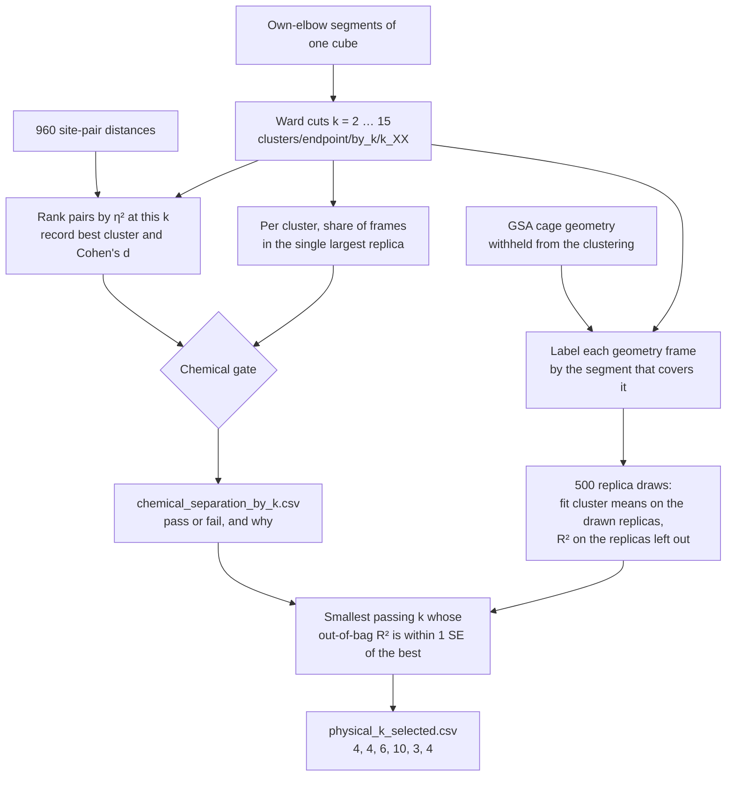

# Metastable structures of the six nanocubes

Methods note for the endpoint changepoint analysis. The states are found from distances between endpoint sites. Murata's cation–π and d1 criteria are applied afterward, to say what those states correspond to in the published classification. Each of the six cubes is analyzed on its own. A cluster in one substitution pattern is not a state of another, and an occupancy is the share of that cube's own apo frames.

The six cubes are BHHpH, BHHpM, BMHpH, BMHpM, BMMpH, and BMMpM. The name records equatorial substitution, then the pole: H is hydrogen and M is methyl. BHHpM, BMHpM, and BMMpM are Murata's 3₆, 2₆, and 1₆. The three pole-hydrogen cubes are not in that series.

## 1. What is measured

An endpoint site is a fused-ring centroid or a single atom site on one of the six monomers. For every pair of monomers the pipeline records the minimum, mean, and maximum site–site distance, and the mean and standard deviation over all such distances. For attribution it also keeps every individual site pair, `endpoint_dist_{i}s{a}_{j}s{b}` (960 columns). These are continuous distances in ångströms. Nothing in this matrix is an open/closed label.

The site index comes from each cube's own hull detection and is not a chemical role. Site 3 is a six-membered ring in BHHpH and a single atom in BMMpM, and site 7 is a ring in both BHH cubes and an atom in the four cubes with equatorial methyls. A label such as `M2S3–M5S3` therefore names a contact inside one cube only. Across cubes, contacts are compared by monomer pair and by where the two monomers sit: on the same pole, as equatorial neighbours (the six d1 edges), or opposite (M0–M3, M1–M4, M2–M5).

Detection and clustering use only columns whose names begin with `endpoint_dist_`. The raw 960 site pairs are left out of detection: they are highly redundant, and after standardization they swamp the monomer-pair summaries. Clustering uses the per-segment mean and standard deviation of the monomer-pair distances. The 960 raw pairs are used only after the clusters exist, to ask which named contacts differ between them.

Two other distances are computed, and are not part of this matrix. Pole cation–π is the distance from a pole pyridinium center to the phenylene center of a locked sandwich. Equatorial d1 is the R2–R3 ipso distance on a locked equatorial edge. Both are measured in a separate motif pass so they can be compared with Murata. `paper_d1_*` and `n_open_cation_pi` are not columns of the clustering.

## 2. Finding the dwells

Each cube is segmented with pruned exact linear time (Pelt) detection on its endpoint-distance summaries. The penalty is that cube's own elbow on a grid referenced to log(n), where n is the median series length. A shared penalty across cubes is not used. The elbows are 4.361 for BHHpH, BHHpM, and BMHpH, 3.466 for BMHpM and BMMpH, and 5.489 for BMMpM.

A segment is a contiguous stretch of one trajectory in which those distances stay in one regime. It is a dwell of the endpoint signal. It is not a free-energy basin, and it is not a Markov state. The endpoint series is sampled every 5 ps. The motif labels used later are computed every 1 ps and are joined onto a segment when the frame falls inside it.

Before clustering, a trajectory is removed if any frame has an assembly radius of gyration above 15 Å or a largest connected component of fewer than six monomers. The component count is the dissociation criterion. The 15 Å gate sits in the gap the 302 replicas actually show: intact cages reach at most 12.2 Å, and the one run that loses a monomer (`BMHpH` `563849`) reaches 34.9 Å on the same frames where the component falls below six. That run is the only exclusion. Loosened but still connected cages, including `BMHpH` `157923`, stay in.

## 3. Clustering, and how k is chosen

Segments of one cube are clustered by Ward's method in the space of their endpoint-distance summaries. The number of clusters is chosen separately for each cube, from the candidates k = 2 through 15. Silhouette is recorded and is not used to choose k.

A candidate passes the chemical gate when the ten site pairs with the largest η² mark at least two clusters of at least five segments, and those clusters differ either in which contacts move or in the sign of the shift (Cohen's d at least 0.5 in both directions). A cluster counts toward those two only if no single replica holds half or more of its frames: a cluster built from one run's excursion is not a state of the ensemble (section 8). The gate inspects a partition that already exists. It does not assign frames.

Among the candidates that pass, each partition is scored by how much variance it explains in cage-geometry descriptors that were withheld from the clustering (the GSA assembly and monomer descriptors, excluding `endpoint_dist_mean`, `endpoint_dist_std`, and the frame-to-frame RMSD). The score is out of bag over replicas: the cluster means are fit without a replica and evaluated on it. Those descriptors are global and do not carry monomer labels, so cutting one deformation into symmetry-related orientations does not improve the score. The reported k is the smallest gated value whose score lies within one replica-bootstrap standard error of the best gated score. The six values are 4, 4, 6, 10, 3, and 4 for BHHpH through BMMpM. The replica condition changes only BMHpH: without it, BMHpH would be cut at k = 4, where the passing split rests on the cluster of replica `157923` alone. BMHpH's held-out score is flat (out-of-bag R² 0.34–0.36 from k = 3 to 15), so its k is set by the gate. A stricter variant that takes the standard error of paired differences between cuts picks k = 13 there, and 6, 4, 14, 3 and 4 for the other cubes. Treat BHHpH (4–6), BMHpH (6–13) and BMHpM (10–14) as ranges. Agreement with Murata's A/B/C1/C2/other labels is computed as normalized mutual information and is stored as an evaluation column. It is not part of the choice.

Cluster integers are arbitrary. They are not matched across cubes or across two values of k for the same cube.

### Pipeline

The choice is two passes over cuts that already exist. The first pass asks whether a cut separates named contacts and whether those clusters recur across replicas. The second scores every cut on cage geometry that the clustering never saw, and keeps the smallest cut that passed and that still predicts that geometry within the noise of the best.



`scripts/compare_endpoint_cluster_k.py --chemical-scan` is the left half, through `chemical_separation_by_k.csv`. `scripts/select_physical_k.py` is the right half. Neither script re-detects changepoints or refits Ward. For the numbers in this note the gate table is `output/endpoint_cluster_chemical_k_own_elbow_replica_aware/chemical_separation_by_k.csv`, and the pick is `output/endpoint_cluster_physical_k_own_elbow/physical_k_selected.csv`.

| Stage | Function | What it writes |
|---|---|---|
| Read one cut | `load_segments_at_k` | labels from `by_k/k_XX/segments_clustered.csv` |
| Rank contacts | `score_cluster_discriminating_features` | η², `best_cluster`, `cohens_d_best` per site pair |
| Replica share | `top_replica_frame_shares` | fraction of a cluster's frames in its largest replica |
| Gate | `assess_chemical_separation` | `chemical_separation` and `fail_reason` |
| Held-out score | `score_held_out_geometry_by_k` | `geometry_r2_oob` and its bootstrap SE |
| Keep a k | `select_k_one_se` | `selected_k` per cube |

### Where the cuts come from

Ward has already been cut at every k from 2 to 15 and written under each cube's own-elbow directory, in `clusters/endpoint/by_k/k_02` through `k_15`. One row of `segments_clustered.csv` is one dwell: `traj_id`, `segment_id`, the frame range, `n_frames`, and `cluster_label`. The chemical scan loads the 960 site-pair segment means once, then for each k replaces the label column by aligning `traj_id` and `segment_id` (`scan_cohort_chemical_k`). Silhouette at that k is copied onto the same row and is stored only. It never enters the gate or the one-SE rule.

### The chemical gate, one cut at a time

For the labels at one k, every site pair is scored by η² of its segment means against the cluster label (section 4). The pair is also given a `best_cluster`, the cluster whose mean differs most from the other segments, and `cohens_d_best`, the signed size of that difference. A positive d is a longer distance in that cluster; a negative d is a shorter one. Pairs are sorted by η². The gate looks at the first ten.

Before those ten are read, each cluster is checked for recurrence. `top_replica_frame_shares` sums `n_frames` by replica inside the cluster and divides the largest replica's frames by the cluster total. With `--max-top-replica-share 0.5`, a cluster at or above one half has its segment count set to 0 for the gate. The segments stay in the partition. They stop counting as a state the ensemble shares. That is why BMHpH at k = 4 fails: the split that would have passed sits on replica `157923`.

A cluster then counts as usable when at least five segments remain. The cut passes `chemical_separation` when the top ten pairs mark at least two usable clusters, and either of these holds:

- the pairs name at least two different contacts (`endpoint_label`), or
- the signed shifts go both ways, with |d| at least 0.5 in each direction (`mixed_cohens_d_signs`).

Otherwise `fail_reason` says why the cut was dropped:

| `fail_reason` | What failed |
|---|---|
| `too_few_usable_clusters` | After the size floor and the replica cap, fewer than two clusters remain |
| `single_marked_cluster` | The top ten pairs all point at one usable cluster |
| `no_distinct_contacts_or_signs` | Two clusters are marked, but the contacts are the same contact and the shifts all lengthen or all shorten |
| empty | The cut passed |

The same ranking also gets a label-shuffle p-value and a Benjamini–Hochberg q-value across the 960 pairs. Those columns are `n_significant_fdr` and `chemical_separation_fdr`. The flag the selector reads is `chemical_separation`, from the top ten pairs. An empty FDR list does not by itself fail a cut: with 960 correlated tests the p-value floor is small, and most pairs clear q < 0.05 once the labels exist.

`scan_chemical_separation_by_k` stacks one row per cube per k into `chemical_separation_by_k.csv`. Columns the later step needs are `cohort`, `k`, `chemical_separation`, `fail_reason`, `silhouette`, and `cluster_sizes`. `single_replica_clusters` lists the clusters the 50% rule zeroed.

### Held-out cage geometry

`select_physical_k.py` reads that table, then scores every k, passing and failing, on the GSA assembly and monomer descriptors. `held_out_geometry_columns` keeps the columns in `GSA_COLS` that are present in `output/gsa_features_by_cube/{CUBE}/*_gsa_features.csv` and drops three: `endpoint_dist_mean` and `endpoint_dist_std`, which duplicate the clustering features, and `assembly_frame_to_frame_rmsd`, which is a frame-to-frame change rather than a property of the dwell. Frames are kept on the endpoint stride, every 5 ps.

Each kept frame inherits the cluster label of the segment that covers it. The geometry columns are z-scored over the cube. Per k the code stores, for every replica and every cluster, the frame count, the sum of each feature, and the sum of squares (`cluster_sufficient_stats`). Any later mean is a ratio of those sums, so the 500 resamples do not revisit the frames.

One resample draws replicas with replacement. Cluster means are fit on the replicas that appear in the draw. R² is evaluated on the replicas that appear in none of the draws. The same 500 draws are used at every k. `geometry_r2_oob` is the mean of those left-out R² values. `geometry_r2_oob_se` is their standard deviation. A cluster that lives in only one replica has no fitted mean when that replica is left out, so its frames are predicted by the grand mean and the cluster adds nothing. The in-sample R², `geometry_r2`, is written beside the out-of-bag score. On nested Ward cuts it rises with k, and the selector does not read it.

The geometry columns carry no monomer index. Two clusters that are the same deformation in two orientations have the same held-out profile, so cutting them apart does not raise the score. That is what lets a later, finer k lose to a smaller one when the extra clusters are orientation copies.

### The one-SE rule

`select_k_one_se` drops every row with `chemical_separation` false. Among the rows that remain it finds the highest `geometry_r2_oob`. Call that best score \(s^\star\) and its bootstrap standard error \(\mathrm{SE}\). The pick is the smallest remaining k whose score is at least \(s^\star - \mathrm{SE}\).

On a toy table the arithmetic is: scores 0.40, 0.50, 0.52 at k = 3, 4, 5, best SE 0.05, so the bar is 0.47. k = 4 clears it and k = 3 does not, so 4 is kept. A higher score at a k that failed the gate is ignored. If the best row has no finite SE, the pick is the gated maximum.

The merged scores are `physical_k_by_k.csv`. The one row per cube is `physical_k_selected.csv`, with `selected_k`, `best_k`, `best_score`, `best_se`, and `gated_k_list`. `gate_only_k` on that table is the smallest passing k with no geometry score applied, so a cube whose score is flat shows the gate and the one-SE rule landing on the same cut. BMHpH is that case: out-of-bag R² stays between 0.34 and 0.36 from k = 3 to 15, and the replica cap is what moves the pick from 4 to 6. `plots/geometry_r2_vs_k.png` draws the score, the SE, an open circle on each passing k, and a star on the pick.

Murata NMI, when `chemical_k_murata_nmi_by_k.csv` is in the same directory, is copied onto the selected row as `murata_nmi_at_selected_k`. It is an evaluation column. The selector never sorts on it.

## 4. Reading a cluster, and merging orientation copies

Once the labels exist, each of the 960 site pairs is scored by how much of its variance lies between clusters. There is one η² per pair, for the whole cube. It is not a variance computed inside one cluster, and it is not a separate number for each segment.

The observation is the segment mean of that pair's distance. Let \(x_i\) be the mean in segment \(i\), \(y_i\) its cluster label, \(\bar{x}\) the mean of those segment means, \(\bar{x}_c\) the mean inside cluster \(c\), and \(n_c\) the number of segments in cluster \(c\). Then

\[
\eta^2 = \frac{\sum_c n_c\,(\bar{x}_c - \bar{x})^2}{\sum_i (x_i - \bar{x})^2}.
\]

The denominator is the scatter of all segment means around the grand mean. The numerator is the scatter of the cluster means around that same grand mean, weighted by cluster size. η² lies between 0 and 1. Zero means every cluster has the same mean distance. One means the segments that share a label share a single distance and the clusters differ. A pair with η² = 0.78 has 78% of its segment-to-segment variance lined up with the cluster label, and the remaining 22% is variation among segments that carry the same label. Pairs are sorted by this fraction. Those at the top are the distances that separate the clusters. The formula is the ordinary correlation ratio from a one-way analysis of variance (`_eta_squared` in `src/ChangepointAnalysis/reporting.py`). It is not partial η², and it is not adjusted for the number of clusters, so it rises with k and is compared only within a cube.

The permutation p-value asks whether that η² is larger than the η² obtained when the same segments are given the cluster labels at random. The distances stay fixed. The label vector is shuffled 999 times, which preserves the cluster sizes, and the same shuffle is applied to every site pair. With \(N = 999\),

\[
p = \frac{1 + \bigl(\text{number of shuffles with }\eta^2 \ge \eta^2_{\text{observed}}\bigr)}{N + 1}.
\]

A small p-value means the pair tracks these labels more tightly than a chance assignment of the same labels. A Benjamini–Hochberg q-value is then taken across the 960 pairs, and a pair is kept as a marker when \(q < 0.05\). Most columns clear that bar. That is expected: the site pairs are strongly correlated, and about 26 principal components account for 80% of their variance, so the list is not 960 independent discoveries.

The p-value calibrates the ranking given the labels. It does not check that the clustering itself was found independently of the endpoint distances. Those clusters were built from monomer-pair summaries of the same distances, so some association is already built in. Which pairs carry the between-cluster difference, beyond a random labeling, is what the shuffle answers. Whether the partition is worth keeping was already decided by the chemical gate and the held-out cage-geometry score in section 3.

Ward keeps the monomer numbering, so one deformation is often stored as several clusters, one for each symmetry-related orientation. To recognize those copies, each cluster is given a deformation profile: the mean change, in ångströms, of every site pair relative to the other clusters of the same cube. The profile is a vector in the endpoint distances, not in d1 or π. Two profiles are compared as labeled, and again after every monomer relabeling that preserves the cage's directed contact graph (the six pole sandwiches and the six equatorial edges; six such relabelings exist). The Pearson correlation after the best relabeling is the symmetry-aware similarity.

Clusters of the same cube whose best-relabelled correlation is at least 0.90 are treated as one structure. The link is single-linkage, so a chain of pairs above 0.90 becomes one family even when the farthest pair is weaker. The family is named by its smallest cluster integer. This merge is what reduces 31 clusters to 19 structures: 3, 2, 4, 5, 3, and 2 for BHHpH through BMMpM. The occupancy of a structure is the sum of its clusters' apo-frame shares inside that cube.

## 5. Mapping onto Murata's classification

Murata's metastructures are an operational classification of frames, published with two fixed cutoffs: a pole cation–π contact is open at 6.5 Å or more, and an equatorial d1 is elongated at 7.0 Å or more. A frame with 0, 1, or 2 open pole contacts is A, B, or C1/C2; C2 additionally requires exactly one elongated d1; every other combination, including three or more open pole contacts, is "other". Those rules are implemented in the motif pass and are joined onto the endpoint segments by trajectory and frame. They do not cut the trajectories, and they do not set `cluster_label`. Changing either cutoff changes how a frame is described. It does not move the frame into a different cluster.

The join is restricted to apo frames, those with no iodide inside the cavity (`n_guest_inside_cavity < 1`), matching Murata's non-encapsulated comparison.

A 1 ps frame can cross 7.0 Å or 6.5 Å for a few picoseconds while the endpoint segment stays put. Most runs of an elongated-edge label are such flickers: of the 36 edge labels that hold at least 5% of a cluster's frames, 34 have a median run of 1–7 ps (the other two, 14 and 25 ps, are the single-edge BMHpM clusters 8 and 2). Frames are another matter: for half of those labels, at least 95% of the frames sit in runs of 20 ps or more. The quantity reported from the mapping is therefore the segment majority: the belt state that covers most of the frames in that segment, and the pole-count bin (0, 1, 2, or 3 or more) that covers most of them. Weighted by frames, the majority belt covers 92–100% of a segment in every cluster except BMHpH cluster 0, the single-replica cluster, where it covers 86%. Segments with the same majority belt are summed inside the cluster. `segment_belt.csv` omits a belt that holds less than 5% of the cluster's apo frames and the frame-level table keeps it; section 7 uses every segment (`--min-share 0`).

Two readings come out of that mapping, and both are descriptions of an endpoint cluster rather than new states.

- In BHHpH and BHHpM, the second elongated edge inside a belt-broken cluster is the other d1 of the same opposite-monomer axis (M5–M0 with M2–M3, M0–M4 with M3–M1, M1–M5 with M4–M2). Each monomer is the r3 end of exactly one equatorial edge, so one stretched axis has two edges that can be the long one. The endpoint deformation profiles of those clusters already match after relabeling. The pole count on those segments splits between two open contacts and three or more.
- In the more methylated cubes, one Ward cluster can contain both intact segments whose majority is a single open pole contact and belt-broken segments whose majority is one elongated edge with two open pole contacts. BMMpM cluster 3 is about half edge M0–M4 at two open poles and about half intact at one open pole.

The short names used in the catalog ("compact cage", "belt broken along M5–M0", "one belt break, N orientations") are this translation. The family membership they are attached to was fixed in section 4.

The 6.5 Å and 7.0 Å lines are Murata's, copied so the comparison uses their measurement. The distance histograms are consistent with them: d1 is compact near 4–5 Å when the pole contacts are closed and develops an elongated shoulder near 8–9 Å as they open. A grid of nearby cutoffs moves 3₆ between C2 and "other" and does not improve the match to their Table 1, because in 3₆ the third pole distance often lies close to 6.5 Å. The lines are therefore kept as the published definition and are not refit.

## 6. What a reported structure is

For one cube, at its selected k:

1. The Ward clusters, ranked by share of that cube's apo frames.
2. The orientation families of section 4, which are the distinct endpoint structures.
3. The site pairs that mark them.
4. The Murata composition of section 5, including the segment-majority belt and pole count inside each cluster.

BMHpH cluster 0 is reported separately from the population structures. It is seven segments of one trajectory, `157923`, a cage that loosens late in the run and stays connected, so the QC rule keeps it. Its contacts should not be read as the cohort's. Section 8 reports it, with the other runs the workflow flags, as an outlier.

A cluster in which one replica holds half or more of the frames but which is an orientation copy of a population cluster is reported inside that structure. BMHpH cluster 2 at k = 6 is the one case: 53% of its frames come from `563849_re`, and its profile matches cluster 3 at r = 0.99.

## 7. Results at the label-free k

These results were regenerated on 14 October 2026 with the replica-aware gate of section 3, which moved BMHpH from k = 4 to k = 6; the other five cubes keep their k and their rows. Each table ranks one cube's structures by their share of that cube's apo frames inside clustered segments. Rows are not matched across cubes. The A / B / C1 / C2 / other columns are Murata's frame labels from section 5, averaged over the structure's apo frames. The segment-majority columns count every segment, with no 5% floor. A broken-belt segment is one whose majority belt has at least one elongated edge.

### Across the six cubes

Three patterns run across the six cubes. They compare how each cube's own structures look; they do not claim that a structure in one cube is a structure of another.

1. A compact cage (at least 90% A frames, essentially no elongated d1) appears only in the four cubes with equatorial methyls. It holds 90.4% of BMMpH, 76.2% of BMMpM, 42.3% of BMHpH and 38.5% of BMHpM. BHHpH and BHHpM have no such structure. Their intact-belt structures (14.5% and 23.1%) are only 27–32% A, because pole contacts open while the belt holds.
2. Where the belt breaks often, it breaks as one deformation seen in several orientations: two in BHHpH, three in BHHpM, six in BMHpM (one per equatorial edge), and three in BMMpM, where broken segments sit beside intact ones with one pole open. BMHpH has two belt-break structures, each in two orientations (r = 0.99 within each); the two match each other at r = 0.80–0.82, below the 0.90 merge line, so they stay separate. In BMMpH the belt breaks in only 20% of one small cluster, so there is nothing to merge.
3. In the four cubes with equatorial methyls, a broken belt comes with exactly two open pole contacts: 94–100% of broken-belt segments, and none with three or more apart from the loosened BMHpH replica. In BHHpH and BHHpM, 30–57% of broken-belt segments in the belt-break and mixed structures have three or more open. Murata's scheme files three or more open contacts as "other", and this is where most of 3₆'s large "other" share comes from.

### BHHpH, k = 4

| Rank | Structure | Clusters | Share of apo frames | Orientations (lowest r) | Segments (replicas) | A / B / C1 / C2 / other (%) | Segment majority: intact / one edge / two+ edges (%) | Broken-belt segments with 2 / 3+ poles open (%) |
|---:|---|---|---:|---|---:|---|---|---|
| 1 | one belt break, 2 orientations | 0, 1 | 57.4% | 2 (0.96) | 223 (36) | 0.1 / 3.9 / 1.5 / 51.4 / 43.1 | 4 / 91 / 5 | 52 / 47 |
| 2 | mixed belt, largest edge M4–M2 | 3 | 28.1% | 1 | 129 (38) | 6.5 / 15.9 / 16.4 / 25.7 / 35.4 | 49 / 46 / 4 | 42 / 57 |
| 3 | intact belt | 2 | 14.5% | 1 | 201 (44) | 26.9 / 28.2 / 30.7 / 6.4 / 7.8 | 94 / 6 / 0 | 84 / 16 |

The belt-break structure joins clusters 0 and 1. Each stretches one opposite-monomer axis by 2.2–2.3 Å (M0–M3 in cluster 0, M1–M4 in cluster 1), and its long d1 is one of the two edges at the ends of that axis. Cluster 3 holds the third axis, M2–M5 (edges M4–M2 and M1–M5), but half of its segment frames have an intact majority, so its profile matches the other two only at r = 0.73–0.79 and it stays a separate, mixed structure. The intact-belt structure is not compact: its segments have zero, one, two and three or more poles open in 30, 26, 36 and 8% of frames. All ten top site pairs mark the belt-break clusters and are shorter there (Cohen's d −2.3 to −4.0). Five join opposite monomers and five join same-pole neighbours.

### BHHpM (Murata 3₆), k = 4

| Rank | Structure | Clusters | Share of apo frames | Orientations (lowest r) | Segments (replicas) | A / B / C1 / C2 / other (%) | Segment majority: intact / one edge / two+ edges (%) | Broken-belt segments with 2 / 3+ poles open (%) |
|---:|---|---|---:|---|---:|---|---|---|
| 1 | one belt break, 3 orientations | 0, 1, 3 | 76.9% | 3 (0.93) | 356 (48) | 0.1 / 7.1 / 1.9 / 51.8 / 39.0 | 4 / 86 / 10 | 66 / 30 |
| 2 | intact belt | 2 | 23.1% | 1 | 182 (50) | 32.1 / 44.8 / 17.2 / 2.8 / 3.0 | 95 / 3 / 2 | 54 / 16 |

The belt-break structure joins clusters 0, 1 and 3 (r = 0.93–0.98) and appears in 48 of the 50 replicas. Each orientation stretches a different opposite axis by 2.0–2.1 Å (M0–M3, M1–M4, M2–M5), with the long d1 at either end of it. The intact-belt structure, cluster 2, holds 98.8% of the cube's A frames and only 1.6% of its C2 and 2.3% of its "other" frames. C2 and "other" fall into the three orientations in similar proportions, so this cut separates belt state and orientation, not C2 from "other". All ten top site pairs mark the belt-break orientations: seven opposite pairs that are shorter in the marked orientation (d −2.7 to −3.4) and three same-pole pairs.

### BMHpH, k = 6

| Rank | Structure | Clusters | Share of apo frames | Orientations (lowest r) | Segments (replicas) | A / B / C1 / C2 / other (%) | Segment majority: intact / one edge / two+ edges (%) | Broken-belt segments with 2 / 3+ poles open (%) |
|---:|---|---|---:|---|---:|---|---|---|
| 1 | compact cage | 1 | 42.3% | 1 | 129 (50) | 95.7 / 4.0 / 0.3 / 0.0 / 0.0 | 100 / 0 / 0 | — |
| 2 | opened cage, 2 orientations | 5, 4 | 36.5% | 2 (0.99) | 85 (29) | 7.4 / 17.9 / 5.6 / 68.6 / 0.6 | 27 / 73 / 0 | 99 / 0 |
| 3 | opened cage, 2 orientations | 3, 2 | 19.7% | 2 (0.99) | 55 (15) | 2.6 / 16.5 / 4.0 / 75.7 / 1.3 | 18 / 82 / 0 | 98 / 0 |
| 4 | loosened single replica, edge M4–M2 | 0 | 1.5% | 1 | 7 (1) | 0.0 / 5.2 / 9.4 / 3.0 / 82.4 | 21 / 29 / 50 | 0 / 100 |

The compact cage, cluster 1, appears in all 50 replicas. The k = 4 cut of the old gate had the same four frame sets; k = 6 splits each belt-break set by edge. Clusters 4 and 5 break at M1–M5/M5–M0 and at M0–M4/M4–M2, and clusters 2 and 3 at M2–M3 and M3–M1; within each pair the profiles match at r = 0.99. The two structures match each other at r = 0.80–0.82 and stay separate. In both, 98–99% of broken-belt segments have exactly two poles open. Cluster 0 is replica `157923` alone; every broken segment in it has three or more poles open, and it is reported separately (sections 6 and 8). At k = 4, six of the ten top site pairs marked that replica. At k = 6 none do: nine mark cluster 5, where same-pole M4–M5 pairs are longer (d +5.6 to +6.3) and equatorial M0–M5 pairs shorter (d −3.5 to −4.0), and one marks cluster 2.

### BMHpM (Murata 2₆), k = 10

| Rank | Structure | Clusters | Share of apo frames | Orientations (lowest r) | Segments (replicas) | A / B / C1 / C2 / other (%) | Segment majority: intact / one edge / two+ edges (%) | Broken-belt segments with 2 / 3+ poles open (%) |
|---:|---|---|---:|---|---:|---|---|---|
| 1 | one belt break, 6 orientations | 1, 2, 6, 7, 4, 8 | 50.3% | 6 (0.90) | 164 (46) | 4.7 / 15.2 / 1.6 / 77.7 / 0.8 | 13 / 87 / 0 | 94 / 0 |
| 2 | compact cage | 0 | 38.5% | 1 | 131 (47) | 96.6 / 3.2 / 0.2 / 0.0 / 0.0 | 100 / 0 / 0 | — |
| 3 | intact belt, M5–M3 often open | 3 | 4.4% | 1 | 38 (16) | 35.9 / 54.1 / 9.1 / 1.0 / 0.0 | 99 / 1 / 0 | 100 / 0 |
| 4 | mostly compact | 5 | 3.7% | 1 | 23 (14) | 53.0 / 32.0 / 10.1 / 1.0 / 3.9 | 100 / 0 / 0 | — |
| 5 | mostly compact | 9 | 3.1% | 1 | 24 (13) | 52.8 / 45.0 / 2.1 / 0.1 / 0.0 | 100 / 0 / 0 | — |

The belt-break structure is six clusters, one for each equatorial edge: in each cluster, 99–100% of the frames with a single long d1 have it on that cluster's edge. Their profiles match at r = 0.90–0.99 after relabelling, and the lowest value involves cluster 7 (edge M4–M2), which is half intact by segment majority. Together they appear in 46 replicas, and 94% of their broken segments have exactly two poles open, none three or more. The compact cage, cluster 0, holds 83.1% of the cube's A frames. Three small intact structures (3.1–4.4% each) are cages whose pole contacts often open (B 32–54%). All ten top site pairs mark belt-break orientations: the four equatorial pairs lengthen (d +6.9 to +10.0), the three same-pole pairs shorten (d −9.0 to −12.0), and the three opposite pairs move both ways.

### BMMpH, k = 3

| Rank | Structure | Clusters | Share of apo frames | Orientations (lowest r) | Segments (replicas) | A / B / C1 / C2 / other (%) | Segment majority: intact / one edge / two+ edges (%) | Broken-belt segments with 2 / 3+ poles open (%) |
|---:|---|---|---:|---|---:|---|---|---|
| 1 | compact cage | 0 | 90.4% | 1 | 166 (50) | 100.0 / 0.0 / 0.0 / 0.0 / 0.0 | 100 / 0 / 0 | — |
| 2 | mixed belt, largest edge M2–M3 | 1 | 5.8% | 1 | 24 (12) | 6.7 / 67.3 / 5.4 / 19.8 / 0.8 | 80 / 20 / 0 | 100 / 0 |
| 3 | intact belt, M1–M2 often open | 2 | 3.8% | 1 | 16 (12) | 13.2 / 85.6 / 1.0 / 0.2 / 0.0 | 100 / 0 / 0 | — |

The compact cage appears in every replica and has no pole open in any segment. In cluster 1, 80% of the frames are intact segments, 86% of them with one pole open; the other 20% are single breaks at M2–M3 with two poles open. Cluster 2 is an intact belt with one pole open in 87% of its frames. Nine of the ten top site pairs mark cluster 1 and are longer there (d +3.0 to +3.8): five same-pole M3–M4 pairs, three opposite M0–M3 pairs and one equatorial M2–M3 pair. The tenth, an opposite M1–M4 pair, is shorter in the compact cage. The orientation merge does not join clusters 1 and 2 (r = 0.73): they open different pole contacts.

### BMMpM (Murata 1₆), k = 4

| Rank | Structure | Clusters | Share of apo frames | Orientations (lowest r) | Segments (replicas) | A / B / C1 / C2 / other (%) | Segment majority: intact / one edge / two+ edges (%) | Broken-belt segments with 2 / 3+ poles open (%) |
|---:|---|---|---:|---|---:|---|---|---|
| 1 | compact cage | 0 | 76.2% | 1 | 76 (47) | 99.9 / 0.1 / 0.0 / 0.0 / 0.0 | 100 / 0 / 0 | — |
| 2 | opened cage, 3 orientations | 3, 1, 2 | 23.8% | 3 (0.82) | 81 (26) | 9.2 / 36.6 / 9.6 / 43.7 / 0.9 | 55 / 45 / 0 | 100 / 0 |

The compact cage appears in 47 of the 51 replicas, has no pole open in any segment, and holds 97.2% of the cube's A frames. The opened-cage structure joins clusters 1, 2 and 3. Neighbouring pairs match at r = 0.93 and 0.94 and the far pair at 0.82, so the three join by single linkage. Its segments are either single breaks at M0–M4, M3–M1, M1–M5 or M5–M0 with exactly two poles open (45% of its frames), or intact (55%, three quarters of them with one pole open). All ten top site pairs mark this structure. Equatorial M2–M4 and M0–M5 pairs are shorter there (d −4.8 to −5.9), equatorial M0–M4 pairs are longer (d +4.2 to +4.5), and the two same-pole M4–M5 pairs move in opposite directions.

The apo-frame shares, Murata labels and segment-majority columns for BMMpM cover 50 of its 51 runs. Run `587901`, truncated at 1,460 frames, has no motif file and is left out of them. It is one silent segment in the compact cage, so the segment and replica counts in the table include it. BMMpM is the only cube with a run missing from the motif pass.

## 8. Outlier runs

The workflow also flags runs that behave unlike the rest of their ensemble. It uses two independent signals, and neither is a classification threshold on the cage's conformation.

- **Dissociation.** The assembly QC of section 2 removes a run in which the cage comes apart. One run of the 302 fails: BMHpH `563849`. Its largest connected component drops to five and later four monomers from frame 4778, and its Rg reaches 34.9 Å.
- **Isolation by clustering.** At every Ward cut from k = 2 to 15, a cluster in which one replica holds at least half of the frames is that run's own excursion. A run that is isolated from a small k onward, and at most cuts, differs from the ensemble more than any state the ensemble shares.

Runs first isolated at k ≤ 6 (Rg rank is over all 302 runs, median Rg maximum 10.9 Å):

| Cube | Run | First isolated at k | Cuts isolated (of 14) | Run's share of the cluster | Window (ps) | Rg max (Å), rank | Note |
|---|---|---:|---:|---:|---|---|---|
| BMHpH | `563849` | — | — | — | from 4778 | 34.9, 1 | dissociates; removed by QC |
| BMHpH | `157923` | 2 | 14 | 100% | 2400–4995 | 12.2, 2 | isolated at the selected k; loosened but connected |
| BHHpH | `907683` | 5 | 11 | 100% | 3650–4995 | 11.9, 3 | loosened but connected |
| BHHpH | `874281` | 6 | 10 | 88% | 1350–4695 | 11.7, 4 | returns before the run ends |
| BMHpH | `563849_re` | 6 | 10 | 53% | 325–4995 | 11.1, 61 | re-run of the dissociated run; orientation copy of a population cluster at the selected k (section 6) |
| BMMpH | `790345` | 4 | 12 | 59% | 2650–4995 | 10.8, 184 | small cluster (6 segments, 3 runs) |
| BMMpH | `840361` | 6 | 10 | 64% | 3250–4995 | 10.7, 210 | small cluster (4 segments, 2 runs) |

The clustering never sees Rg. Even so, the three runs it isolates first and most completely in the pole-H cubes, `157923`, `907683` and `874281`, have the second, third and fourth largest Rg maxima of all 302 runs. The only run above them is the one that dissociates. These are cages that loosen late and stay connected, so the QC keeps them by design, and the clustering picks them out on its own. The two BMMpH runs differ by contacts rather than by size (Rg ranks 184 and 210), and their clusters are small. Sixteen more runs are first isolated only at k ≥ 7, with a median Rg rank of 44. Fine cuts carve out single runs, so isolation that begins late carries little weight.

The same 50% share sets the replica condition of the chemical gate (section 3), so a run flagged here cannot by itself make a cut pass. At the selected k, only BMHpH carries flagged clusters: `157923` as its own structure and `563849_re` inside an orientation pair.

## Reproducibility

| Step in this note | Script | Main output |
|---|---|---|
| 2–3 | `scripts/cluster_changepoint_segments.py`, `scripts/compare_endpoint_cluster_k.py --chemical-scan --max-top-replica-share 0.5`, `scripts/select_physical_k.py` | `output/endpoint_cluster_chemical_k_own_elbow_replica_aware/`, `output/endpoint_cluster_physical_k_own_elbow/physical_k_selected.csv`, and `clusters/endpoint/by_k/` under each own-elbow directory |
| 4 | `scripts/describe_endpoint_clusters.py`, `scripts/rank_endpoint_pairs_at_k.py`, `scripts/rank_metastable_structures.py` | `output/endpoint_cluster_profiles/`, `output/endpoint_pair_ranking_physical_k/`, `output/metastable_structures_physical_k/by_cube/{CUBE}.csv` |
| 5 | `scripts/compute_murata_motif_rmsd.py`, `scripts/compare_to_murata_metastructures.py`, `scripts/categorize_cluster_mixtures.py` | `output/{CUBE}_motif_rmsd/`, `output/murata_g5_own_elbow_physical_k/`, `output/metastable_structures_physical_k/segment_belt.csv` |
| 7 | `scripts/categorize_cluster_mixtures.py --min-share 0`, `scripts/summarize_metastable_structures.py` | `output/metastable_structures_physical_k/min_share_0/`, `structures_summary.csv`, `structure_markers.csv` |
| 8 | `scripts/detect_replica_outliers.py`, `scripts/audit_cluster_replicas.py --min-top-share 0.5` | `output/replica_outliers/`, `output/cluster_replica_audit_physical_k/` |

The k scan and selection come first:

```powershell
python scripts/compare_endpoint_cluster_k.py --own-elbow --chemical-scan --chemical-k-max 15 --max-top-replica-share 0.5 --out-dir output/endpoint_cluster_chemical_k_own_elbow_replica_aware
python scripts/select_physical_k.py --own-elbow --chem-dir output/endpoint_cluster_chemical_k_own_elbow_replica_aware
```

`select_physical_k.py` copies Murata NMI into its table only as an evaluation column, from `chemical_k_murata_nmi_by_k.csv` in `--chem-dir` (NMI per k does not depend on the gate).

`rank_metastable_structures.py` reads every profile folder whose name starts with `{CUBE}_k{XX}`. Three of them were written with an explicit cluster list, because the default contrast set (clusters whose frames are mostly elongated) leaves out the half-broken BMHpM cluster 7 and the non-compact clusters of BMMpH and BMMpM:

```powershell
python scripts/describe_endpoint_clusters.py --own-elbow --cube BHHpH --k 4
python scripts/describe_endpoint_clusters.py --own-elbow --cube BHHpM --k 4
python scripts/describe_endpoint_clusters.py --own-elbow --cube BMHpH --k 6
python scripts/describe_endpoint_clusters.py --own-elbow --cube BMHpM --k 10
python scripts/describe_endpoint_clusters.py --own-elbow --cube BMHpM --k 10 --clusters 1 2 4 6 7 8 --out-dir output/endpoint_cluster_profiles/BMHpM_k10_all_edges
python scripts/describe_endpoint_clusters.py --own-elbow --cube BMMpM --k 4
python scripts/describe_endpoint_clusters.py --own-elbow --cube BMMpM --k 4 --clusters 1 2 3 --out-dir output/endpoint_cluster_profiles/BMMpM_k04_noncompact
python scripts/describe_endpoint_clusters.py --own-elbow --cube BMMpH --k 3 --clusters 1 2 --out-dir output/endpoint_cluster_profiles/BMMpH_k03_noncompact
```

Then:

```powershell
python scripts/rank_metastable_structures.py
python scripts/categorize_cluster_mixtures.py
python scripts/categorize_cluster_mixtures.py --min-share 0 --out-dir output/metastable_structures_physical_k/min_share_0
python scripts/summarize_metastable_structures.py
python scripts/audit_cluster_replicas.py --own-elbow --k-selected output/endpoint_cluster_physical_k_own_elbow/physical_k_selected.csv --min-top-share 0.5 --out-dir output/cluster_replica_audit_physical_k
python scripts/detect_replica_outliers.py
python -m pytest tests/test_metastable_catalog.py tests/test_physical_k.py tests/test_cluster_attribution.py tests/test_cluster_replicas.py -q --disable-warnings
```

`rank_metastable_structures.py` reads the profiles from step 4 and writes `clusters_ranked.csv`, `families_ranked.csv`, and `by_cube/{CUBE}.csv`. `--copy-r` (default 0.90) is the correlation in section 4. `categorize_cluster_mixtures.py` is the mapping in section 5. `--min-share` (default 5) is the reporting floor for `segment_belt.csv`. In that file, `pct_2_poles = 80` means 80% of the frames in that belt mode belong to segments whose majority pole count is two. It is not the fraction of individual frames with two open contacts. `belt_inside_cluster.csv` is the frame-level count, with `median_dwell_ps` and the fraction of frames that sit in runs of at least 20 ps. `cluster_mixture.csv` has one row per cluster. The column `n_categories_ge_5pct` counts belt categories at `--min-share`.

`summarize_metastable_structures.py` writes the section 7 numbers: `structures_summary.csv` has one row per structure (share, orientations, segments, replicas as the union over the structure's clusters, the Murata label mix, the segment-majority shares and the pole count inside broken and intact segments), and `structure_markers.csv` maps each cube's top site pairs onto structures with the relation of the two monomers.

Helpers live in `src/ChangepointAnalysis/metastable_catalog.py`. The tests cover the orientation merge, the post-hoc names, the belt and pole labels, the dwell split, and the monomer-pair relations used for markers. They do not read `output/`. `tests/test_physical_k.py` covers the replica share used by the gate, and `tests/test_cluster_replicas.py` the isolation sweep of section 8.
