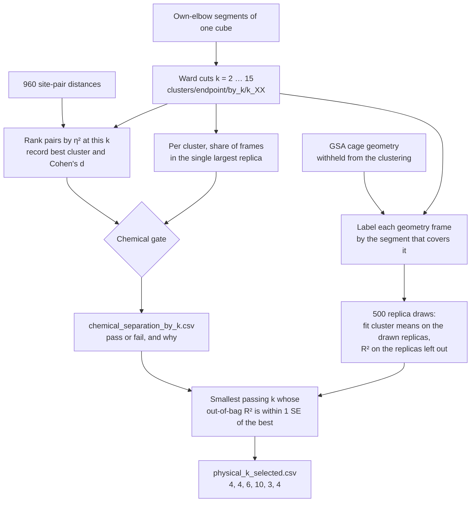

# Metastable structures of the six nanocubes

Methods note for the endpoint changepoint analysis. The states are found from distances between endpoint sites. Murata's cation–π and d1 criteria are applied afterward, to say what those states correspond to in the published classification. Each of the six cubes is analyzed on its own. A cluster in one substitution pattern is not a state of another, and an occupancy is the share of that cube's own apo frames.

The six cubes are BHHpH, BHHpM, BMHpH, BMHpM, BMMpH, and BMMpM. The name records equatorial substitution, then the pole: H is hydrogen and M is methyl. BHHpM, BMHpM, and BMMpM are Murata's 3₆, 2₆, and 1₆. The three pole-hydrogen cubes are not in that series.

## 1. What is measured

An endpoint site is a fused-ring centroid or a single atom site on one of the six monomers. For every pair of monomers the pipeline records the minimum, mean, and maximum site–site distance, and the mean and standard deviation over all such distances. For attribution it also keeps every individual site pair, `endpoint_dist_{i}s{a}_{j}s{b}` (960 columns). These are continuous distances in ångströms. Nothing in this matrix is an open/closed label.

The site index comes from each cube's own hull detection and is not a chemical role. Site 3 is a six-membered ring in BHHpH and a single atom in BMMpM, and site 7 is a ring in both BHH cubes and an atom in the four cubes with equatorial methyls. A label such as `M2S3–M5S3` therefore names a contact inside one cube only. Across cubes, contacts are compared by monomer pair and by where the two monomers sit: on the same pole, as equatorial neighbours (the six d1 edges), or opposite (M0–M3, M1–M4, M2–M5).

Detection and clustering use only columns whose names begin with `endpoint_dist_`. The raw 960 site pairs are left out of detection: they are highly redundant, and after standardization they swamp the monomer-pair summaries. Clustering uses the per-segment mean and standard deviation of the monomer-pair distances. The 960 raw pairs are used only after the clusters exist, to ask which named contacts differ between them.

Two other distances are computed, and are not part of this matrix. Pole cation–π is the distance from a pole pyridinium center to the phenylene center of a locked sandwich. Equatorial d1 is the R2–R3 ipso distance on a locked equatorial edge. Both are measured in a separate motif pass so they can be compared with Murata. `paper_d1_*` and `n_open_cation_pi` are not columns of the clustering.

## 2. Finding the dwells

Each cube is segmented with pruned exact linear time (Pelt) detection on its endpoint-distance summaries. The penalty is that cube's own elbow on a grid referenced to log(n), where n is the median series length. A shared penalty across cubes is not used. The elbows are 4.361 for BHHpH, BHHpM, and BMHpH, 3.466 for BMHpM and BMMpH, and 5.489 for BMMpM.

A segment is a contiguous stretch of one trajectory in which those distances stay in one regime. It is a dwell of the endpoint signal. It is not a free-energy basin, and it is not a Markov state. The endpoint series is sampled every 5 ps. The motif labels used later are computed every 1 ps and are joined onto a segment when the frame falls inside it.

Before clustering, a trajectory is removed if any frame has an assembly radius of gyration above 15 Å or a largest connected component of fewer than six monomers. The component count is the dissociation criterion. The 15 Å gate sits in the gap the 302 replicas actually show: intact cages reach at most 12.2 Å, and the one run that loses a monomer (`BMHpH` `563849`) reaches 34.9 Å on the same frames where the component falls below six. That run is the only exclusion. Loosened but still connected cages, including `BMHpH` `157923`, stay in.

## 3. Clustering, and how k is chosen

Segments of one cube are clustered by Ward's method in the space of their endpoint-distance summaries. The number of clusters is chosen separately for each cube, from the candidates k = 2 through 15. Silhouette is recorded and is not used to choose k.

A candidate passes the chemical gate when the ten site pairs with the largest η² mark at least two clusters of at least five segments, and those clusters differ either in which contacts move or in the sign of the shift (Cohen's d at least 0.5 in both directions). A cluster counts toward those two only if no single replica holds half or more of its frames: a cluster built from one run's excursion is not a state of the ensemble (section 8). The gate inspects a partition that already exists. It does not assign frames.

Among the candidates that pass, each partition is scored by how much variance it explains in cage-geometry descriptors that were withheld from the clustering (the GSA assembly and monomer descriptors, excluding `endpoint_dist_mean`, `endpoint_dist_std`, and the frame-to-frame RMSD). The score is out of bag over replicas: the cluster means are fit without a replica and evaluated on it. Those descriptors are global and do not carry monomer labels, so cutting one deformation into symmetry-related orientations does not improve the score. The reported k is the smallest gated value whose score lies within one replica-bootstrap standard error of the best gated score. The six values are 4, 4, 6, 10, 3, and 4 for BHHpH through BMMpM. The replica condition changes only BMHpH: without it, BMHpH would be cut at k = 4, where the passing split rests on the cluster of replica `157923` alone. BMHpH's held-out score is flat (out-of-bag R² 0.34–0.36 from k = 3 to 15), so its k is set by the gate. A stricter variant that takes the standard error of paired differences between cuts picks k = 13 there, and 6, 4, 14, 3 and 4 for the other cubes. Treat BHHpH (4–6), BMHpH (6–13) and BMHpM (10–14) as ranges. Agreement with Murata's A/B/C1/C2/other labels is computed as normalized mutual information and is stored as an evaluation column. It is not part of the choice.

Cluster integers are arbitrary. They are not matched across cubes or across two values of k for the same cube.

### Pipeline

The choice is two passes over cuts that already exist. The first pass asks whether a cut separates named contacts and whether those clusters recur across replicas. The second scores every cut on cage geometry that the clustering never saw, and keeps the smallest cut that passed and that still predicts that geometry within the noise of the best.



`scripts/compare_endpoint_cluster_k.py --chemical-scan` is the left half, through `chemical_separation_by_k.csv`. `scripts/select_physical_k.py` is the right half. Neither script re-detects changepoints or refits Ward. For the numbers in this note the gate table is `output/endpoint_cluster_chemical_k_own_elbow_replica_aware/chemical_separation_by_k.csv`, and the pick is `output/endpoint_cluster_physical_k_own_elbow/physical_k_selected.csv`.

| Stage | Function | What it writes |
|---|---|---|
| Read one cut | `load_segments_at_k` | labels from `by_k/k_XX/segments_clustered.csv` |
| Rank contacts | `score_cluster_discriminating_features` | η², `best_cluster`, `cohens_d_best` per site pair |
| Replica share | `top_replica_frame_shares` | fraction of a cluster's frames in its largest replica |
| Gate | `assess_chemical_separation` | `chemical_separation` and `fail_reason` |
| Held-out score | `score_held_out_geometry_by_k` | `geometry_r2_oob` and its bootstrap SE |
| Keep a k | `select_k_one_se` | `selected_k` per cube |

### Where the cuts come from

Ward has already been cut at every k from 2 to 15 and written under each cube's own-elbow directory, in `clusters/endpoint/by_k/k_02` through `k_15`. One row of `segments_clustered.csv` is one dwell: `traj_id`, `segment_id`, the frame range, `n_frames`, and `cluster_label`. The chemical scan loads the 960 site-pair segment means once, then for each k replaces the label column by aligning `traj_id` and `segment_id` (`scan_cohort_chemical_k`). Silhouette at that k is copied onto the same row and is stored only. It never enters the gate or the one-SE rule.

### The chemical gate, one cut at a time

For the labels at one k, every site pair is scored by η² of its segment means against the cluster label (section 4). The pair is also given a `best_cluster`, the cluster whose mean differs most from the other segments, and `cohens_d_best`, the signed size of that difference. A positive d is a longer distance in that cluster; a negative d is a shorter one. Pairs are sorted by η². The gate looks at the first ten.

Before those ten are read, each cluster is checked for recurrence. `top_replica_frame_shares` sums `n_frames` by replica inside the cluster and divides the largest replica's frames by the cluster total. With `--max-top-replica-share 0.5`, a cluster at or above one half has its segment count set to 0 for the gate. The segments stay in the partition. They stop counting as a state the ensemble shares. That is why BMHpH at k = 4 fails: the split that would have passed sits on replica `157923`.

A cluster then counts as usable when at least five segments remain. The cut passes `chemical_separation` when the top ten pairs mark at least two usable clusters, and either of these holds:

- the pairs name at least two different contacts (`endpoint_label`), or
- the signed shifts go both ways, with |d| at least 0.5 in each direction (`mixed_cohens_d_signs`).

Otherwise `fail_reason` says why the cut was dropped:

| `fail_reason` | What failed |
|---|---|
| `too_few_usable_clusters` | After the size floor and the replica cap, fewer than two clusters remain |
| `single_marked_cluster` | The top ten pairs all point at one usable cluster |
| `no_distinct_contacts_or_signs` | Two clusters are marked, but the contacts are the same contact and the shifts all lengthen or all shorten |
| empty | The cut passed |

The same ranking also gets a label-shuffle p-value and a Benjamini–Hochberg q-value across the 960 pairs. Those columns are `n_significant_fdr` and `chemical_separation_fdr`. The flag the selector reads is `chemical_separation`, from the top ten pairs. An empty FDR list does not by itself fail a cut: with 960 correlated tests the p-value floor is small, and most pairs clear q < 0.05 once the labels exist.

`scan_chemical_separation_by_k` stacks one row per cube per k into `chemical_separation_by_k.csv`. Columns the later step needs are `cohort`, `k`, `chemical_separation`, `fail_reason`, `silhouette`, and `cluster_sizes`. `single_replica_clusters` lists the clusters the 50% rule zeroed.

### Held-out cage geometry

`select_physical_k.py` reads that table, then scores every k, passing and failing, on the GSA assembly and monomer descriptors. `held_out_geometry_columns` keeps the columns in `GSA_COLS` that are present in `output/gsa_features_by_cube/{CUBE}/*_gsa_features.csv` and drops three: `endpoint_dist_mean` and `endpoint_dist_std`, which duplicate the clustering features, and `assembly_frame_to_frame_rmsd`, which is a frame-to-frame change rather than a property of the dwell. Frames are kept on the endpoint stride, every 5 ps.

Each kept frame inherits the cluster label of the segment that covers it. The geometry columns are z-scored over the cube. Per k the code stores, for every replica and every cluster, the frame count, the sum of each feature, and the sum of squares (`cluster_sufficient_stats`). Any later mean is a ratio of those sums, so the 500 resamples do not revisit the frames.

One resample draws replicas with replacement. Cluster means are fit on the replicas that appear in the draw. R² is evaluated on the replicas that appear in none of the draws. The same 500 draws are used at every k. `geometry_r2_oob` is the mean of those left-out R² values. `geometry_r2_oob_se` is their standard deviation. A cluster that lives in only one replica has no fitted mean when that replica is left out, so its frames are predicted by the grand mean and the cluster adds nothing. The in-sample R², `geometry_r2`, is written beside the out-of-bag score. On nested Ward cuts it rises with k, and the selector does not read it.

The geometry columns carry no monomer index. Two clusters that are the same deformation in two orientations have the same held-out profile, so cutting them apart does not raise the score. That is what lets a later, finer k lose to a smaller one when the extra clusters are orientation copies.

### The one-SE rule

`select_k_one_se` drops every row with `chemical_separation` false. Among the rows that remain it finds the highest `geometry_r2_oob`. Call that best score \(s^\star\) and its bootstrap standard error \(\mathrm{SE}\). The pick is the smallest remaining k whose score is at least \(s^\star - \mathrm{SE}\).

On a toy table the arithmetic is: scores 0.40, 0.50, 0.52 at k = 3, 4, 5, best SE 0.05, so the bar is 0.47. k = 4 clears it and k = 3 does not, so 4 is kept. A higher score at a k that failed the gate is ignored. If the best row has no finite SE, the pick is the gated maximum.

The merged scores are `physical_k_by_k.csv`. The one row per cube is `physical_k_selected.csv`, with `selected_k`, `best_k`, `best_score`, `best_se`, and `gated_k_list`. `gate_only_k` on that table is the smallest passing k with no geometry score applied, so a cube whose score is flat shows the gate and the one-SE rule landing on the same cut. BMHpH is that case: out-of-bag R² stays between 0.34 and 0.36 from k = 3 to 15, and the replica cap is what moves the pick from 4 to 6. `plots/geometry_r2_vs_k.png` draws the score, the SE, an open circle on each passing k, and a star on the pick.

Murata NMI, when `chemical_k_murata_nmi_by_k.csv` is in the same directory, is copied onto the selected row as `murata_nmi_at_selected_k`. It is an evaluation column. The selector never sorts on it.

## 4. Reading a cluster, and merging orientation copies

Once the labels exist, each of the 960 site pairs is scored by how much of its variance lies between clusters. There is one η² per pair, for the whole cube. It is not a variance computed inside one cluster, and it is not a separate number for each segment.

The observation is the segment mean of that pair's distance. Let \(x_i\) be the mean in segment \(i\), \(y_i\) its cluster label, \(\bar{x}\) the mean of those segment means, \(\bar{x}_c\) the mean inside cluster \(c\), and \(n_c\) the number of segments in cluster \(c\). Then

\[
\eta^2 = \frac{\sum_c n_c\,(\bar{x}_c - \bar{x})^2}{\sum_i (x_i - \bar{x})^2}.
\]

The denominator is the scatter of all segment means around the grand mean. The numerator is the scatter of the cluster means around that same grand mean, weighted by cluster size. η² lies between 0 and 1. Zero means every cluster has the same mean distance. One means the segments that share a label share a single distance and the clusters differ. A pair with η² = 0.78 has 78% of its segment-to-segment variance lined up with the cluster label, and the remaining 22% is variation among segments that carry the same label. Pairs are sorted by this fraction. Those at the top are the distances that separate the clusters. The formula is the ordinary correlation ratio from a one-way analysis of variance (`_eta_squared` in `src/ChangepointAnalysis/reporting.py`). It is not partial η², and it is not adjusted for the number of clusters, so it rises with k and is compared only within a cube.

The permutation p-value asks whether that η² is larger than the η² obtained when the same segments are given the cluster labels at random. The distances stay fixed. The label vector is shuffled 999 times, which preserves the cluster sizes, and the same shuffle is applied to every site pair. With \(N = 999\),

\[
p = \frac{1 + \bigl(\text{number of shuffles with }\eta^2 \ge \eta^2_{\text{observed}}\bigr)}{N + 1}.
\]

A small p-value means the pair tracks these labels more tightly than a chance assignment of the same labels. A Benjamini–Hochberg q-value is then taken across the 960 pairs, and a pair is kept as a marker when \(q < 0.05\). Most columns clear that bar. That is expected: the site pairs are strongly correlated, and about 26 principal components account for 80% of their variance, so the list is not 960 independent discoveries.

The p-value calibrates the ranking given the labels. It does not check that the clustering itself was found independently of the endpoint distances. Those clusters were built from monomer-pair summaries of the same distances, so some association is already built in. Which pairs carry the between-cluster difference, beyond a random labeling, is what the shuffle answers. Whether the partition is worth keeping was already decided by the chemical gate and the held-out cage-geometry score in section 3.

Ward keeps the monomer numbering, so one deformation is often stored as several clusters, one for each symmetry-related orientation. To recognize those copies, each cluster is given a deformation profile: the mean change, in ångströms, of every site pair relative to the mean of all clustered segments of that cube. The profile is a vector in the endpoint distances, not in d1 or π. Two profiles are compared as labeled, and again after every monomer relabeling that preserves the cage's directed contact graph (the six pole sandwiches and the six equatorial edges; six such relabelings exist). The Pearson correlation after the best relabeling is the symmetry-aware similarity. Every pair of clusters of the cube is scored. The merge does not depend on which clusters `describe_endpoint_clusters.py --clusters` contrasted for the site-pair ranking.

Clusters of the same cube whose best-relabelled correlation is at least 0.95 are treated as one structure. The link is single-linkage, so a chain of pairs above 0.95 becomes one family even when the farthest pair is weaker. The family is named by its smallest cluster integer. This merge reduces 31 clusters to 22 structures: 4, 3, 4, 5, 3, and 3 for BHHpH through BMMpM. The occupancy of a structure is the sum of its clusters' apo-frame shares inside that cube.

A lower line at 0.90 would still keep BMHpM's six belt-break orientations, but it would also join that family to the intact clusters 3, 5 and 9 (the strongest links are 3–9 at 0.95, 7–9 at 0.91 and 3–7 at 0.89). The 0.95 line leaves those intact clusters as their own structures and still joins the six belt-break copies, whose weakest pair is 7–8 at 0.89 and which join through stronger neighbours (4–7 at 0.96, 1–8 at 0.99). An earlier catalog of 19 structures used 0.90 and only the pairs that had been contrasted. For BMHpM those were clusters 1, 2, 4, 6, 7 and 8, so 3, 5 and 9 could not merge. That count mixed the rule with the contrast set. The numbers in section 7 use all-cluster correlations at 0.95.

## 5. Mapping onto Murata's classification

Murata's metastructures are an operational classification of frames, published with two fixed cutoffs: a pole cation–π contact is open at 6.5 Å or more, and an equatorial d1 is elongated at 7.0 Å or more. A frame with 0, 1, or 2 open pole contacts is A, B, or C1/C2; C2 additionally requires exactly one elongated d1; every other combination, including three or more open pole contacts, is "other". Those rules are implemented in the motif pass and are joined onto the endpoint segments by trajectory and frame. They do not cut the trajectories, and they do not set `cluster_label`. Changing either cutoff changes how a frame is described. It does not move the frame into a different cluster.

The join is restricted to apo frames, those with no iodide inside the cavity (`n_guest_inside_cavity < 1`), matching Murata's non-encapsulated comparison.

A 1 ps frame can cross 7.0 Å or 6.5 Å for a few picoseconds while the endpoint segment stays put. Most runs of an elongated-edge label are such flickers: of the 36 edge labels that hold at least 5% of a cluster's frames, 34 have a median run of 1–7 ps (the other two, 14 and 25 ps, are the single-edge BMHpM clusters 8 and 2). Frames are another matter: for half of those labels, at least 95% of the frames sit in runs of 20 ps or more. The quantity reported from the mapping is therefore the segment majority: the belt state that covers most of the frames in that segment, and the pole-count bin (0, 1, 2, or 3 or more) that covers most of them. Weighted by frames, the majority belt covers 92–100% of a segment in every cluster except BMHpH cluster 0, the single-replica cluster, where it covers 86%. Segments with the same majority belt are summed inside the cluster. `segment_belt.csv` omits a belt that holds less than 5% of the cluster's apo frames and the frame-level table keeps it; section 7 uses every segment (`--min-share 0`).

Two readings come out of that mapping, and both are descriptions of an endpoint cluster rather than new states.

- In BHHpH and BHHpM, the second elongated edge inside a belt-broken cluster is the other d1 of the same opposite-monomer axis (M5–M0 with M2–M3, M0–M4 with M3–M1, M1–M5 with M4–M2). Each monomer is the r3 end of exactly one equatorial edge, so one stretched axis has two edges that can be the long one. The endpoint deformation profiles of those clusters already match after relabeling. The pole count on those segments splits between two open contacts and three or more.
- In the more methylated cubes, one Ward cluster can contain both intact segments whose majority is a single open pole contact and belt-broken segments whose majority is one elongated edge with two open pole contacts. BMMpM cluster 3 is about half edge M0–M4 at two open poles and about half intact at one open pole.

The short names used in the catalog ("compact cage", "belt broken along M5–M0", "one belt break, N orientations") are this translation. The family membership they are attached to was fixed in section 4.

The 6.5 Å and 7.0 Å lines are Murata's, copied so the comparison uses their measurement. The distance histograms are consistent with them: d1 is compact near 4–5 Å when the pole contacts are closed and develops an elongated shoulder near 8–9 Å as they open. A grid of nearby cutoffs moves 3₆ between C2 and "other" and does not improve the match to their Table 1, because in 3₆ the third pole distance often lies close to 6.5 Å. The lines are therefore kept as the published definition and are not refit.

## 6. What a reported structure is

For one cube, at its selected k:

1. The Ward clusters, ranked by share of that cube's apo frames.
2. The orientation families of section 4, which are the distinct endpoint structures.
3. The site pairs that mark them.
4. The Murata composition of section 5, including the segment-majority belt and pole count inside each cluster.

BMHpH cluster 0 is reported separately from the population structures. It is seven segments of one trajectory, `157923`, a cage that loosens late in the run and stays connected, so the QC rule keeps it. Its contacts should not be read as the cohort's. Section 8 reports it, with the other runs the workflow flags, as an outlier.

A cluster in which one replica holds half or more of the frames but which is an orientation copy of a population cluster is reported inside that structure. BMHpH cluster 2 at k = 6 is the one case: 53% of its frames come from `563849_re`, and its profile matches cluster 3 at r = 0.99.

## 7. Results at the label-free k

These results were regenerated on 28 October 2026 with the all-cluster orientation merge of section 4 (r ≥ 0.95). The replica-aware gate of section 3, from 14 October 2026, still sets k at 4, 4, 6, 10, 3 and 4. Each table ranks one cube's structures by their share of that cube's apo frames inside clustered segments. Rows are not matched across cubes. The A / B / C1 / C2 / other columns are Murata's frame labels from section 5, averaged over the structure's apo frames. The segment-majority columns count every segment, with no 5% floor. A broken-belt segment is one whose majority belt has at least one elongated edge.

### Across the six cubes

Three patterns run across the six cubes. They compare how each cube's own structures look; they do not claim that a structure in one cube is a structure of another.

1. A compact cage (at least 90% A frames, essentially no elongated d1) appears only in the four cubes with equatorial methyls. It holds 90.4% of BMMpH, 76.2% of BMMpM, 42.3% of BMHpH and 38.5% of BMHpM. BHHpH and BHHpM have no such structure. Their intact-belt structures (14.5% and 23.1%) are only 27–32% A, because pole contacts open while the belt holds.
2. Where the belt breaks often, it breaks as one deformation seen in several orientations: two in BHHpM (clusters 1 and 3, r = 0.96), six in BMHpM (one per equatorial edge; weakest pair 0.89, joined through neighbours above 0.95), and two in BMMpM (clusters 2 and 3, r = 0.95). BHHpH's two clean belt-break clusters (0 and 1) match at r = 0.93, below the line, so they stay two structures on different edges. BMHpH has two belt-break structures, each in two orientations (r = 0.97 and 0.98); the two match each other at r = 0.72–0.77, so they stay separate under the whole-cluster rule. The catalog counts them as two. A label-free core/weak split (§9 D3) shows what {4, 5} is: the {2, 3} deformation in two further orientations, mixed with a weaker, non-compact state that makes up 54–61% of their frames. In BMMpH the belt breaks in only 20% of one small cluster, so there is nothing to merge.
3. In the four cubes with equatorial methyls, a broken belt comes with exactly two open pole contacts: 94–100% of broken-belt segments, and none with three or more apart from the loosened BMHpH replica. In BHHpH and BHHpM, 30–57% of broken-belt segments in the belt-break and mixed structures have three or more open. Murata's scheme files three or more open contacts as "other", and this is where most of 3₆'s large "other" share comes from.

### BHHpH, k = 4

| Rank | Structure | Clusters | Share of apo frames | Orientations (lowest r) | Segments (replicas) | A / B / C1 / C2 / other (%) | Segment majority: intact / one edge / two+ edges (%) | Broken-belt segments with 2 / 3+ poles open (%) |
|---:|---|---|---:|---|---:|---|---|---|
| 1 | belt broken along M5–M0 | 0 | 36.9% | 1 | 116 (18) | 0.0 / 4.4 / 1.8 / 51.7 / 42.1 | 4 / 88 / 8 | 53 / 46 |
| 2 | mixed belt, largest edge M4–M2 | 3 | 28.1% | 1 | 129 (38) | 6.5 / 15.9 / 16.4 / 25.7 / 35.4 | 49 / 46 / 4 | 42 / 57 |
| 3 | belt broken along M0–M4 | 1 | 20.5% | 1 | 107 (19) | 0.1 / 3.0 / 1.0 / 51.0 / 44.8 | 2 / 98 / 0 | 52 / 48 |
| 4 | intact belt | 2 | 14.5% | 1 | 201 (44) | 26.9 / 28.2 / 30.7 / 6.4 / 7.8 | 94 / 6 / 0 | 84 / 16 |

Clusters 0 and 1 are the two clean belt breaks, on M5–M0 and M0–M4. Their profiles match at r = 0.93 after relabelling, just below 0.95, so they stay two structures. Cluster 3 holds the third axis (edges M4–M2 and M1–M5), but half of its segment frames have an intact majority, and it matches 0 and 1 only at r = 0.80 and 0.74. The intact-belt structure is not compact: its segments have zero, one, two and three or more poles open in 30, 26, 36 and 8% of frames. All ten top site pairs mark the belt-break clusters and are shorter there (Cohen's d −2.3 to −4.0). Five join opposite monomers and five join same-pole neighbours.

### BHHpM (Murata 3₆), k = 4

| Rank | Structure | Clusters | Share of apo frames | Orientations (lowest r) | Segments (replicas) | A / B / C1 / C2 / other (%) | Segment majority: intact / one edge / two+ edges (%) | Broken-belt segments with 2 / 3+ poles open (%) |
|---:|---|---|---:|---|---:|---|---|---|
| 1 | one belt break, 2 orientations | 1, 3 | 41.0% | 2 (0.96) | 188 (26) | 0.0 / 5.7 / 1.4 / 56.0 / 36.9 | 3 / 88 / 8 | 72 / 26 |
| 2 | belt broken along M5–M0 | 0 | 35.9% | 1 | 168 (26) | 0.2 / 8.7 / 2.5 / 47.1 / 41.5 | 4 / 83 / 13 | 59 / 34 |
| 3 | intact belt | 2 | 23.1% | 1 | 182 (50) | 32.1 / 44.8 / 17.2 / 2.8 / 3.0 | 95 / 3 / 2 | 54 / 16 |

Clusters 1 and 3 join at r = 0.96 (edges M0–M4 and M4–M2 / M1–M5). Cluster 0 is the third belt break (M5–M0); it matches them at r = 0.94 and 0.93, below 0.95, so it stays its own structure. The intact-belt structure, cluster 2, holds 98.8% of the cube's A frames and only 1.6% of its C2 and 2.3% of its "other" frames. C2 and "other" fall into the belt-break clusters in similar proportions, so this cut separates belt state and orientation, not C2 from "other". All ten top site pairs mark the belt-break clusters: seven opposite pairs that are shorter in the marked cluster (d −2.7 to −3.4) and three same-pole pairs.

### BMHpH, k = 6

| Rank | Structure | Clusters | Share of apo frames | Orientations (lowest r) | Segments (replicas) | A / B / C1 / C2 / other (%) | Segment majority: intact / one edge / two+ edges (%) | Broken-belt segments with 2 / 3+ poles open (%) |
|---:|---|---|---:|---|---:|---|---|---|
| 1 | compact cage | 1 | 42.3% | 1 | 129 (50) | 95.7 / 4.0 / 0.3 / 0.0 / 0.0 | 100 / 0 / 0 | — |
| 2 | opened cage, 2 orientations | 5, 4 | 36.5% | 2 (0.97) | 85 (29) | 7.4 / 17.9 / 5.6 / 68.6 / 0.6 | 27 / 73 / 0 | 99 / 0 |
| 3 | opened cage, 2 orientations | 3, 2 | 19.7% | 2 (0.98) | 55 (15) | 2.6 / 16.5 / 4.0 / 75.7 / 1.3 | 18 / 82 / 0 | 98 / 0 |
| 4 | loosened single replica, edge M4–M2 | 0 | 1.5% | 1 | 7 (1) | 0.0 / 5.2 / 9.4 / 3.0 / 82.4 | 21 / 29 / 50 | 0 / 100 |

The compact cage, cluster 1, appears in all 50 replicas. The k = 4 cut of the old gate had the same four frame sets; k = 6 splits each belt-break set by edge. Clusters 4 and 5 break at M1–M5/M5–M0 and at M0–M4/M4–M2, and clusters 2 and 3 at M2–M3 and M3–M1; within each pair the profiles match at r = 0.97 and 0.98. The two structures match each other at r = 0.72–0.77 and stay separate. In both, 98–99% of broken-belt segments have exactly two poles open. Cluster 0 is replica `157923` alone; every broken segment in it has three or more poles open, and it is reported separately (sections 6 and 8). At k = 4, six of the ten top site pairs marked that replica. At k = 6 none do: nine mark cluster 5, where same-pole M4–M5 pairs are longer (d +5.6 to +6.3) and equatorial M0–M5 pairs shorter (d −3.5 to −4.0), and one marks cluster 2.

### BMHpM (Murata 2₆), k = 10

| Rank | Structure | Clusters | Share of apo frames | Orientations (lowest r) | Segments (replicas) | A / B / C1 / C2 / other (%) | Segment majority: intact / one edge / two+ edges (%) | Broken-belt segments with 2 / 3+ poles open (%) |
|---:|---|---|---:|---|---:|---|---|---|
| 1 | one belt break, 6 orientations | 1, 2, 6, 7, 4, 8 | 50.3% | 6 (0.89) | 164 (46) | 4.7 / 15.2 / 1.6 / 77.7 / 0.8 | 13 / 87 / 0 | 94 / 0 |
| 2 | compact cage | 0 | 38.5% | 1 | 131 (47) | 96.6 / 3.2 / 0.2 / 0.0 / 0.0 | 100 / 0 / 0 | — |
| 3 | intact belt, M5–M3 often open | 3 | 4.4% | 1 | 38 (16) | 35.9 / 54.1 / 9.1 / 1.0 / 0.0 | 99 / 1 / 0 | 100 / 0 |
| 4 | mostly compact | 5 | 3.7% | 1 | 23 (14) | 53.0 / 32.0 / 10.1 / 1.0 / 3.9 | 100 / 0 / 0 | — |
| 5 | mostly compact | 9 | 3.1% | 1 | 24 (13) | 52.8 / 45.0 / 2.1 / 0.1 / 0.0 | 100 / 0 / 0 | — |

The belt-break structure is six clusters, one for each equatorial edge: in each cluster, 99–100% of the frames with a single long d1 have it on that cluster's edge. Neighbouring copies match at r = 0.96–0.99 after relabelling. The weakest pair is 7–8 at 0.89 (cluster 7 is half intact by segment majority); single linkage still joins all six because 4–7 is 0.96 and 1–8 is 0.99. Together they appear in 46 replicas, and 94% of their broken segments have exactly two poles open, none three or more. The compact cage, cluster 0, holds 83.1% of the cube's A frames. Three small intact structures (3.1–4.4% each) are cages whose pole contacts often open (B 32–54%). They match the belt-break family at r = 0.83–0.91 and stay separate at 0.95. All ten top site pairs mark belt-break orientations: the four equatorial pairs lengthen (d +6.9 to +10.0), the three same-pole pairs shorten (d −9.0 to −12.0), and the three opposite pairs move both ways.

### BMMpH, k = 3

| Rank | Structure | Clusters | Share of apo frames | Orientations (lowest r) | Segments (replicas) | A / B / C1 / C2 / other (%) | Segment majority: intact / one edge / two+ edges (%) | Broken-belt segments with 2 / 3+ poles open (%) |
|---:|---|---|---:|---|---:|---|---|---|
| 1 | compact cage | 0 | 90.4% | 1 | 166 (50) | 100.0 / 0.0 / 0.0 / 0.0 / 0.0 | 100 / 0 / 0 | — |
| 2 | mixed belt, largest edge M2–M3 | 1 | 5.8% | 1 | 24 (12) | 6.7 / 67.3 / 5.4 / 19.8 / 0.8 | 80 / 20 / 0 | 100 / 0 |
| 3 | intact belt, M1–M2 often open | 2 | 3.8% | 1 | 16 (12) | 13.2 / 85.6 / 1.0 / 0.2 / 0.0 | 100 / 0 / 0 | — |

The compact cage appears in every replica and has no pole open in any segment. In cluster 1, 80% of the frames are intact segments, 86% of them with one pole open; the other 20% are single breaks at M2–M3 with two poles open. Cluster 2 is an intact belt with one pole open in 87% of its frames. Nine of the ten top site pairs mark cluster 1 and are longer there (d +3.0 to +3.8): five same-pole M3–M4 pairs, three opposite M0–M3 pairs and one equatorial M2–M3 pair. The tenth, an opposite M1–M4 pair, is shorter in the compact cage. The orientation merge does not join clusters 1 and 2 (r = 0.66): they open different pole contacts.

### BMMpM (Murata 1₆), k = 4

| Rank | Structure | Clusters | Share of apo frames | Orientations (lowest r) | Segments (replicas) | A / B / C1 / C2 / other (%) | Segment majority: intact / one edge / two+ edges (%) | Broken-belt segments with 2 / 3+ poles open (%) |
|---:|---|---|---:|---|---:|---|---|---|
| 1 | compact cage | 0 | 76.2% | 1 | 76 (47) | 99.9 / 0.1 / 0.0 / 0.0 / 0.0 | 100 / 0 / 0 | — |
| 2 | opened cage, 2 orientations | 3, 2 | 15.6% | 2 (0.95) | 54 (19) | 10.3 / 29.5 / 8.9 / 50.1 / 1.2 | 48 / 52 / 0 | 100 / 0 |
| 3 | mixed belt, largest edge M3–M1 | 1 | 8.2% | 1 | 27 (9) | 7.0 / 50.0 / 11.0 / 31.6 / 0.4 | 69 / 31 / 0 | 100 / 0 |

The compact cage appears in 47 of the 51 replicas, has no pole open in any segment, and holds 97.2% of the cube's A frames. Clusters 2 and 3 join at r = 0.95 (edges M1–M5 and M0–M4). Cluster 1 is mixed at M3–M1; it matches them at r = 0.92 and 0.82, so it stays its own structure. The opened pair's segments are either single breaks with exactly two poles open or intact with one pole open. All ten top site pairs mark the non-compact clusters. Equatorial M2–M4 and M0–M5 pairs are shorter there (d −4.8 to −5.9), equatorial M0–M4 pairs are longer (d +4.2 to +4.5), and the two same-pole M4–M5 pairs move in opposite directions.

The apo-frame shares, Murata labels and segment-majority columns for BMMpM cover 50 of its 51 runs. Run `587901`, truncated at 1,460 frames, has no motif file and is left out of them. It is one silent segment in the compact cage, so the segment and replica counts in the table include it. BMMpM is the only cube with a run missing from the motif pass.

## 8. Outlier runs

The workflow also flags runs that behave unlike the rest of their ensemble. It uses two independent signals, and neither is a classification threshold on the cage's conformation.

- **Dissociation.** The assembly QC of section 2 removes a run in which the cage comes apart. One run of the 302 fails: BMHpH `563849`. Its largest connected component drops to five and later four monomers from frame 4778, and its Rg reaches 34.9 Å.
- **Isolation by clustering.** At every Ward cut from k = 2 to 15, a cluster in which one replica holds at least half of the frames is that run's own excursion. A run that is isolated from a small k onward, and at most cuts, differs from the ensemble more than any state the ensemble shares.

Runs first isolated at k ≤ 6 (Rg rank is over all 302 runs, median Rg maximum 10.9 Å):

| Cube | Run | First isolated at k | Cuts isolated (of 14) | Run's share of the cluster | Window (ps) | Rg max (Å), rank | Note |
|---|---|---:|---:|---:|---|---|---|
| BMHpH | `563849` | — | — | — | from 4778 | 34.9, 1 | dissociates; removed by QC |
| BMHpH | `157923` | 2 | 14 | 100% | 2400–4995 | 12.2, 2 | isolated at the selected k; loosened but connected |
| BHHpH | `907683` | 5 | 11 | 100% | 3650–4995 | 11.9, 3 | loosened but connected |
| BHHpH | `874281` | 6 | 10 | 88% | 1350–4695 | 11.7, 4 | returns before the run ends |
| BMHpH | `563849_re` | 6 | 10 | 53% | 325–4995 | 11.1, 61 | re-run of the dissociated run; orientation copy of a population cluster at the selected k (section 6) |
| BMMpH | `790345` | 4 | 12 | 59% | 2650–4995 | 10.8, 184 | small cluster (6 segments, 3 runs) |
| BMMpH | `840361` | 6 | 10 | 64% | 3250–4995 | 10.7, 210 | small cluster (4 segments, 2 runs) |

The clustering never sees Rg. Even so, the three runs it isolates first and most completely in the pole-H cubes, `157923`, `907683` and `874281`, have the second, third and fourth largest Rg maxima of all 302 runs. The only run above them is the one that dissociates. These are cages that loosen late and stay connected, so the QC keeps them by design, and the clustering picks them out on its own. The two BMMpH runs differ by contacts rather than by size (Rg ranks 184 and 210), and their clusters are small. Sixteen more runs are first isolated only at k ≥ 7, with a median Rg rank of 44. Fine cuts carve out single runs, so isolation that begins late carries little weight.

The same 50% share sets the replica condition of the chemical gate (section 3), so a run flagged here cannot by itself make a cut pass. At the selected k, only BMHpH carries flagged clusters: `157923` as its own structure and `563849_re` inside an orientation pair.

## 9. Structural checks on the clusters

The four tests below do not re-segment or choose a new k. They read the Ward labels at the selected k (section 3) and the merged structures of section 7, and ask whether those sets are compact, unimodal, shared across replicas, and whether the orientation merge is supported. The unit is the segment mean, which is what Ward clustered. Distances are a symmetry-adjusted RMSD over the 960 inter-monomer site pairs, in Å: for two vectors x and y, d(x, y) is the minimum over admissible monomer relabellings g of the RMSD between x and y with its columns permuted by g. Nothing is aligned in Cartesian space. The distance describes how the monomers sit relative to one another. It cannot tell a structure from its mirror image; that is settled on coordinates in D1.

Outputs live in `output/endpoint_cluster_validation_physical_k/`. The primary run uses every frame inside a clustered segment, which is what Ward saw. A second run with `--apo-only` repeats Tests A–D after dropping frames that have iodide in the cavity; that filter and its results are in the last subsection.

### D1. Which relabellings are physically admissible

`scripts/check_cage_symmetry.py` builds a compact-cage reference from each local pole-methyl trajectory (`BHHpM_109345`, `BMHpM_109345`, `BMMpM_891249`), then tests the 48 adjacency-preserving monomer permutations: 24 rotations and 24 improper operations. Each relabelled cage is superimposed twice, once with rotations only and once allowing a reflection, using the RDKit heavy-atom graph automorphism inside each monomer. An operation is admissible when it is one of the six contact-graph automorphisms (section 4) and its self-RMSD is within the thermal frame-to-frame RMSD of the same frames. An improper operation can pass only if the cage superimposes on its own mirror image.

All six contact automorphisms pass on every cube. The three proper 3-folds match with a rotation (self-RMSD 0.16–1.26 Å). The inversion and the two S6 6-cycles match only when a reflection is allowed (0.15–1.16 Å) and fail by 10–11 Å with rotations only, so the compact cages are achiral and the mirrors stay in the group. The remaining 42 adjacency permutations fail both tests. Site maps from Hungarian matching of endpoint centroids are the identity: site a stays site a under every admissible operation. The three pole-H cubes have no local trajectory; each inherits the result of the pole-methyl cube with the same equator and is flagged `inferred`. Thermal scales are 0.79 Å (BHH), 0.69 Å (BMH) and 0.62 Å (BMM).

### Test A. Intracluster diameter

For every Ward cluster and every merged structure the script records the maximum, 95th percentile and median pairwise distance, the same three numbers with fixed monomer labels, the pair that sets the maximum, and each member's eccentricity as a robust z-score. Diameters are read against the within-dwell spread (the median frame-to-frame distance inside one segment, 1.03–1.29 Å).

The compact cages are the tightest sets. Their 95th percentiles are 0.73 Å (BMMpM 0), 0.92 Å (BMMpH 0), 1.24 Å (BMHpH 1), 1.43 Å (BMHpM 0), 1.89 Å (BHHpH 2) and 2.16 Å (BHHpM 2). The opened and belt-break clusters sit at 2.3–4.0 Å. Symmetry adjustment shrinks the labelled diameter: a family of orientations that looks 3–4 Å wide at fixed labels is 1.4–2.4 Å after relabelling. The maximum is set by one or two segments and grows with cluster size, so clusters are compared on the 95th percentile and the median. Compact cages still list eccentric members (6–33) because the MAD of a tight set is small; those members remain inside 1.1–1.8 Å of the medoid. BMHpH cluster 0 (`157923` alone) has no eccentric flag and a median of 2.66 Å: it is a loose single-replica set, not a compact outlier.

Separation over the 95th percentile is above 1 only between a compact cage and an opened structure (BMMpM 0: 1.88; BMMpH 0: 1.31; BMHpH 1: 1.19; BHHpM 2: 1.10). Orientation copies of one motif sit at 0.35–0.62, as they should: after the best relabelling they occupy the same region.

### Test B. Distributions inside a cluster

Each observable is the median of the frames inside a segment: pole cation–π (sorted and per sandwich), equatorial d1 and d2, assembly Rg, shape anisotropy and asphericity, the symmetry-adjusted RMSD to the cluster medoid, GSA contact counts, and the number of adjacent interfaces whose minimum endpoint distance exceeds the compact cage's 99th percentile. A one-component and a two-component Gaussian mixture are compared on clusters with at least 15 segments. The flag `two_populations` requires ΔBIC ≥ 10, Ashman's D ≥ 2, a minor component of at least 15% of segments, and those segments from at least three replicas.

Most clusters flag on at least one observable. The flags are not all the same thing.

- **Motif counts.** `n_open_cation_pi`, the second-largest pole distance, `equator_d1_erank1` and `n_broken_adjacent` split the opened clusters. That is the mixture already in section 7: a belt-break cluster still contains intact segments, and an intact cluster still contains frames with one pole open. BMHpM cluster 2 is the exception (`homogeneous` on every observable).
- **Cage geometry.** Compact cages of BMHpM, BMMpH and BMMpM also split on Rg and on the total number of inter-monomer contacts. The compact set is not a single size. BHHpH 0 and BHHpM 0 split on shape anisotropy and on RMSD to the medoid.
- **After reorientation.** The two-population test is repeated on the first principal components of the site-pair vectors after every segment is moved into the family template. A split that disappears was two orientations of one motif. A split that remains is a candidate second deformation. It remains in BHHpH 0, BHHpM 2, BMHpH 1 and 5, BMHpM 0 and 1, BMMpH 2, and BMMpM 1 and 3. The compact-cage splits (BHHpM 2, BMHpH 1, BMHpM 0) are a size or tightness variation, not a second belt motif. The opened-cluster splits that remain line up with the intact / one-edge mix of section 7.

Clusters with fewer than 15 segments (BMHpH 0 and 2) are summarized and not tested.

### Test C. Stability across replicas

Refitting Ward on all replicas reproduces the stored `by_k` labels exactly (ARI = 1) on every cube. Replicas are then split five ways, twenty times. Each held-out segment is assigned to the nearest training centroid, once from a Ward refit on the training replicas and once from the reported labels restricted to those replicas. The two variants agree. A cluster is `reproducible` when coverage of the training 95th-percentile radius is at least 0.8, the deformation-profile r between held-out and training members is at least 0.8, and the top-10 site pairs keep their Cohen's d sign in at least 90% of folds.

| Cube | Reproducible | Not reproducible | Why the others fail |
|---|---|---|---|
| BHHpH | 0, 1 | 2 (sign 0.86), 3 (r 0.64, sign 0.78) | compact cage and cluster 3 mix more than one deformation |
| BHHpM | 0, 3 | 1 (sign 0.83), 2 (sign 0.87) | coverage and r pass; the top-10 signs do not |
| BMHpH | 1, 3, 5 | 0 (single replica), 2 (coverage 0.75, sign 0.78), 4 (r 0.78) | 0 is `157923`; 2 is 53% `563849_re` (section 8) |
| BMHpM | 0, 1, 2, 3, 6, 8, 9 | 4 (sign 0.79), 5 (r 0.77), 7 (sign 0.78) | the half-broken edge (cluster 7) and two small intact sets |
| BMMpH | — | 0, 1, 2 | compact cage: r 0.79; opened: r 0.64–0.65 |
| BMMpM | 0 | 1 (r 0.79), 2 (coverage 0.73, r 0.64), 3 (r 0.77) | the opened pair and the mixed cluster |

Coverage is 0.85–0.94 on every cluster that has more than one replica except BMHpH 2 and BMMpM 2. The stricter gate is the profile r. On a compact cage the deformation vector is near zero, so r between one replica and the rest is noise: BMMpH 0 has coverage 0.94 and sign agreement 0.92, and fails only because r is 0.788. The same holds for many single-replica comparisons inside compact cages. Sign agreement below 0.9 marks clusters whose top contacts are not the same contacts in every replica fold (BHHpH 2 and 3, BHHpM 1 and 2, BMHpM 4 and 7).

### D2–D5. Effects of the symmetry merge

**D2.** Each published family is moved into the orientation of its largest member. The families at r ≥ 0.95 are BHHpM 1+3, the two BMHpH pairs, BMHpM's six belt-break copies, and BMMpM 2+3. BHHpH has no family of two or more clusters. The family's 95th-percentile distance over that member's is 0.95–1.11 (threshold 1.2), so the merge does not inflate the diameter. After reorientation, replica-grouped classification of member identity sits at the label-permutation null for BHHpM 1+3 (0.48 against 0.50) and for the two BMHpH pairs (0.37–0.48 against 0.50). The six BMHpM copies sit at 0.26 against a six-class null of 0.17. BMMpM 2+3 is the exception: balanced accuracy 0.76 against 0.50, energy p = 0.035, so those two clusters still separate after reorientation even though their profiles meet r = 0.95. Energy-distance tests on BHHpM 1+3 and the two BMHpH pairs do not reject a single distribution (p 0.61–0.75). Relabelling shares are 0.57–0.96; the lower values are families whose members already sit near the identity.

**D3.** Pairs that were left apart, or joined only through a chain, should still separate after the same reorientation. Correlations are the all-cluster values of section 4.

| Pair | r in section 4 | Balanced accuracy (null) | Energy p | Separates |
|---|---:|---|---:|---|
| BHHpH 0 vs 1 | 0.93 | 0.46 (0.49) | 0.59 | no |
| BHHpH 3 vs 0 | 0.80 | 0.80 (0.50) | 0.005 | yes |
| BHHpH 3 vs 1 | 0.74 | 0.78 (0.51) | 0.005 | yes |
| BMHpH 4 vs 2 | 0.72 | 0.67 (0.52) | 0.43 | yes |
| BMHpH 4 vs 3 | 0.75 | 0.51 (0.51) | 0.19 | no |
| BMHpH 5 vs 2 | 0.73 | 0.65 (0.50) | 0.57 | yes |
| BMHpH 5 vs 3 | 0.77 | 0.51 (0.48) | 0.48 | no |
| BMMpH 1 vs 2 | 0.66 | 0.76 (0.51) | 0.005 | yes |
| BMMpM 1 vs 3 | 0.82 | 0.62 (0.49) | 0.06 | yes |
| BMHpM 2 vs 7 | 0.90 | 0.90 (0.51) | 0.005 | yes |

BHHpH 0 vs 1 is the pair the 0.95 line just misses (r = 0.93). After reorientation they occupy the same region (the numbers are the former family check). BHHpM cluster 0 matches 1 and 3 at r = 0.94 and 0.93 and is left apart by the same line. BMHpH 4 and 5 against 3 also do not separate: those four clusters are two published structures (4+5 and 2+3) whose profiles already match at r = 0.72–0.77; after reorientation, 4/5 and 3 occupy the same region. The next paragraph tests whether that is a missed merge (it most likely is). BMHpM 2 and 7 stay apart, which is why cluster 7 is in the six-orientation family only by single linkage (through 4–7 at 0.96) and not by complete linkage.

**Is BMHpH {4, 5} a missed merge with {2, 3}?** Yes, most likely. Clusters 4 and 5 are each a mixture: a core that carries the same deformation as {2, 3}, in two further orientations, and a larger part that is a weaker, different state. The whole-cluster r of 0.72–0.77 is the mixture's average, not a second belt-break deformation.

The test asks whether weakly deformed segments inside a cluster pull its deformation profile toward the grand mean and hide a match. If they do, removing them should raise the cross-structure correlation to the level of orientation copies. The split is label-free, so no structural threshold decides it.

`scripts/check_merge_dilution.py` does this with the catalog's own profile and symmetry code:

1. The segments of each cluster are cut in two by Ward on their site-pair segment means, standardized over every clustered segment of the cube (`core_split` in `src/ChangepointAnalysis/cluster_validation.py`). This is the clustering step of the pipeline, applied inside one cluster.
2. The part whose mean lies farther from the grand mean is the core; the other is the weak part. Nothing else names them.
3. Each part gets a deformation profile computed as the catalog computes it: the mean of the 960 site-pair segment means of that part minus the mean over every clustered segment of the cube.
4. Profiles are compared by Pearson r after the best of the six contact automorphisms (section 4). The script also reports the best r over all four core/weak combinations, and matches each weak part to its nearest other cluster.

| Pair | Whole clusters | Cores | Weak parts |
|---|---:|---:|---:|
| 2–3 (same structure) | 0.98 | 1.00 | 0.82 |
| 4–5 (same structure) | 0.97 | 0.99 | 0.96 |
| 2 or 3 vs 4 or 5 (across) | 0.72–0.77 | 0.98–0.99 | 0.63–0.70 |
| 1 (compact cage) vs 2–5 | −0.05 to −0.03 | 0.29–0.39 | 0.02–0.09 |

| Cluster | Core segments (frames) | Weak segments (frames) | Replicas in core (top share) |
|---|---:|---:|---:|
| 2 | 6 (89%) | 4 (11%) | 2 (0.50) |
| 3 | 23 (81%) | 22 (19%) | 7 (0.22) |
| 4 | 9 (39%) | 34 (61%) | 4 (0.33) |
| 5 | 10 (46%) | 32 (54%) | 5 (0.40) |

Each core pair uses the same best relabelling as the whole-cluster pair, so the cores are the same deformation in the orientations the catalog already assigned. Clusters 2 and 3 are mostly core. Clusters 4 and 5 are mostly weak part, and that is what lowers their whole-cluster r with 2 and 3. The weak parts of 4 and 5 match each other (0.96) but not the compact cage (0.02–0.09), so they are a second, consistent state: non-compact, with a milder pattern that resembles cluster 3 at r = 0.86–0.91 without matching it.

**Is the core match an artifact of picking the most deformed segments?** Two checks say no.

- *Calibration on every other pair.* The same split was run on every cluster pair of the other five cubes (`--clusters` with all labels). Selecting extreme segments does inflate r for unrelated pairs: pairs with whole r near 0 rise to 0.15–0.82 on cores, the most for small cores (BMHpM 0–9, 11 and 9 core segments, 0.28 → 0.82). Among cross-family near-misses (whole r ≥ 0.70, at least five core segments per side), the cores mostly stay below the line or fall: BHHpH 0–1 0.93 → 0.88, 1–3 0.74 → 0.81; BMHpM 4–9 0.84 → 0.85, 7–9 0.91 → 0.85, 3–9 0.95 → 0.34. One pair crosses: BHHpM 0–1, already at 0.94, moves to 0.95. Pairs that are already copies stay at 0.94–0.99. Only BMHpH {2, 3} vs {4, 5} moves from well below the line (0.72–0.77) to copy level.
- *Replica bootstrap* (`scripts/bootstrap_core_match.py`). Over 200 draws of replicas with replacement, re-splitting each time, the cross-structure core r has a median of 0.98 (2.5–97.5%: 0.90–0.99) and is ≥ 0.95 in 93–99% of draws. The within-structure values are 0.99 (2–3) and 0.98 (4–5). The cores of 4 and 5 come from four and five replicas (top share 0.33 and 0.40). Cluster 2's core is the thinnest: 6 segments from two replicas, half of them from `563849_re` (§6). Pairs with cluster 2 have 164 usable draws, because its core falls below three segments in the rest. The 3 vs 4/5 pairs, which do not involve cluster 2, give the same answer (median 0.98, P ≥ 0.95 in 95–98% of draws).

**Why the earlier belt-based split said the opposite.** An earlier version of this check split segments by majority belt (an elongated d1 at ≥ 7.0 Å, the threshold from the reference analysis). That gave broken-belt parts at 0.73–0.77 across, and the conclusion "not a missed merge". The post-hoc cross-table (`--belt-crosscheck`, `BMHpH_k06_core_vs_belt.csv`) shows why. Of the 13 and 15 broken-belt segments of clusters 4 and 5, 6 and 7 fall in the weak part. Crossing the 7.0 Å line on one edge does not mean a segment carries the deformation, so the threshold put weak segments in with the deformed ones and kept the dilution. The label-free split separates them, and every intact-belt segment of 4 and 5 (27 of 27, 21 of 21) lands in the weak part. The belt labels describe the parts well after the fact; they were the wrong tool for making the split.

This now agrees with the segment-level classifier and energy tests in the table above, which could not tell 4 or 5 from 3.

**Consequence for the catalog.** The merge rule compares whole clusters, so it still lists BMHpH as four structures. If merges were judged on cores, with at least five core segments per side, BMHpH {2, 3, 4, 5} would be one belt-break deformation in four orientations, and BMHpH would have three structures. The same rule would also join BHHpM 0 with {1, 3} (core r 0.952, a pair already at 0.94 on whole clusters), so BHHpM would have two, and the total would be 20 instead of 22. No other cube changes.

**Decision (Oct 28): the catalog keeps the whole-cluster rule and 22 structures.** The merge rule stays the one stated in section 4, applied to whole clusters, with no second rule added after the fact. BMHpH keeps four structures. In the description, {4, 5} is reported as the {2, 3} belt-break deformation in two further orientations, mixed with a weaker, non-compact state that makes up 54–61% of the frames of each cluster. The core/weak split and the bootstrap are a validation reported here, not a step that changes the catalog.

The per-part counts are `BMHpH_k06_merge_dilution_parts.csv`, the correlations `BMHpH_k06_merge_dilution_pairs.csv`, the pair verdicts `tangled_inspect.csv` and the post-hoc belt table `BMHpH_k06_core_vs_belt.csv`, all under `output/endpoint_cluster_validation_physical_k/merge_dilution/bmhph_listed/`. The all-pair calibration runs are under `merge_dilution/all_pairs/{CUBE}/`, and the bootstrap (`BMHpH_k06_core_bootstrap.csv`, per-draw values and the core replica table) under `merge_dilution/core_bootstrap/`.

**D4.** Families are rebuilt under the admissible group, rotations only, and all six contact relabellings, at copy-r 0.80, 0.85, 0.90 and 0.95, with single and complete linkage. Admissible and contact are the same group (D1), and they give the same families. Under rotations only, BMHpM's six orientations fall into {1, 4, 7} and {2, 6, 8}, as a 3-fold cannot map every equatorial edge onto every other.

At the published rule (single linkage, r = 0.95, admissible group, every cluster of the cube) the counts are those of section 7: 4, 3, 4, 5, 3 and 3. Lowering the line to 0.90 over-merges three cubes: BHHpH joins 0 with 1; BHHpM joins 0 with 1 and 3; BMHpM joins the intact clusters 3, 5 and 9 to the belt-break family, leaving two structures instead of five; BMMpM joins 1 with 2 and 3. Complete linkage at 0.90 splits BMHpM's belt family into {1, 2, 6, 8} and {4, 7} and joins 3 with 9. BHHpH at 0.80 single linkage also joins 3. BMMpH never merges. BMHpH's two opened structures stay separate at every threshold in the grid.

**D5.** Side by side, a merged structure has a 95th-percentile diameter within 3% of its largest member (Test A), inherits that member's two-population flags (Test B), and is reproducible when every member is (Test C). The BMHpM belt-break structure (clusters 1, 2, 4, 6, 7, 8) is the mixed case: four members are reproducible and two are not. BHHpH has no merged structure at 0.95. BMMpM 2+3 is merge-supported on diameter (ratio 1.07) but the two members still separate after reorientation (D2).

### Verdicts at the selected k

One row per Ward cluster. Test A reports the 95th-percentile symmetry-adjusted diameter; `outlier_driven` means at least one member has eccentricity z > 3.5 (and at least 0.5 Å from the others). Test B is `two_populations` if any tested observable meets the four gates above. Test C uses the no-refit hold-out. Test D is `merge_supported` when the cluster belongs to a published family whose p95 ratio is at most 1.2; `not_merged` means the cluster is its own structure. BMHpH 0 has no hold-out (one replica). BHHpH and BMMpH have no published family of two or more clusters.

| Cube | Cluster | Structure (section 7) | p95 (Å) | Test B | Test C | Test D |
|---|---:|---|---:|---|---|---|
| BHHpH | 0 | belt broken along M5–M0 | 3.56 | two populations | reproducible | not merged |
| BHHpH | 1 | belt broken along M0–M4 | 3.26 | two populations | reproducible | not merged |
| BHHpH | 2 | intact belt | 1.89 | two populations | not reproducible (sign 0.86) | not merged |
| BHHpH | 3 | mixed belt, largest edge M4–M2 | 3.74 | two populations | not reproducible (r 0.64) | not merged |
| BHHpM | 0 | belt broken along M5–M0 | 3.74 | two populations | reproducible | not merged |
| BHHpM | 1 | one belt break, 2 orientations | 4.02 | two populations | not reproducible (sign 0.83) | merge supported |
| BHHpM | 2 | intact belt | 2.16 | two populations | not reproducible (sign 0.87) | not merged |
| BHHpM | 3 | one belt break, 2 orientations | 3.34 | two populations | reproducible | merge supported |
| BMHpH | 0 | loosened single replica | 3.20 | untested (7 segments) | single replica | not merged |
| BMHpH | 1 | compact cage | 1.24 | two populations | reproducible | not merged |
| BMHpH | 2 | opened cage, 2 orientations | 2.35 | untested (10 segments) | not reproducible (coverage 0.75) | merge supported |
| BMHpH | 3 | opened cage, 2 orientations | 2.48 | two populations | reproducible | merge supported |
| BMHpH | 4 | opened cage, 2 orientations | 2.34 | two populations | not reproducible (r 0.78) | merge supported |
| BMHpH | 5 | opened cage, 2 orientations | 2.27 | two populations | reproducible | merge supported |
| BMHpM | 0 | compact cage | 1.43 | two populations | reproducible | not merged |
| BMHpM | 1 | one belt break, 6 orientations | 2.37 | two populations | reproducible | merge supported |
| BMHpM | 2 | one belt break, 6 orientations | 1.78 | homogeneous | reproducible | merge supported |
| BMHpM | 3 | intact belt, M5–M3 often open | 1.91 | two populations | reproducible | not merged |
| BMHpM | 4 | one belt break, 6 orientations | 2.50 | two populations | not reproducible (sign 0.79) | merge supported |
| BMHpM | 5 | mostly compact | 1.73 | two populations | not reproducible (r 0.77) | not merged |
| BMHpM | 6 | one belt break, 6 orientations | 1.98 | two populations | reproducible | merge supported |
| BMHpM | 7 | one belt break, 6 orientations | 2.39 | two populations | not reproducible (sign 0.78) | merge supported |
| BMHpM | 8 | one belt break, 6 orientations | 1.59 | two populations | reproducible | merge supported |
| BMHpM | 9 | mostly compact | 1.34 | two populations | reproducible | not merged |
| BMMpH | 0 | compact cage | 0.92 | two populations | not reproducible (r 0.79) | not merged |
| BMMpH | 1 | mixed belt, largest edge M2–M3 | 2.31 | two populations | not reproducible (r 0.64) | not merged |
| BMMpH | 2 | intact belt, M1–M2 often open | 1.85 | two populations | not reproducible (r 0.65) | not merged |
| BMMpM | 0 | compact cage | 0.73 | two populations | reproducible | not merged |
| BMMpM | 1 | mixed belt, largest edge M3–M1 | 3.08 | two populations | not reproducible (r 0.79) | not merged |
| BMMpM | 2 | opened cage, 2 orientations | 3.13 | two populations | not reproducible (coverage 0.73) | merge supported |
| BMMpM | 3 | opened cage, 2 orientations | 3.11 | two populations | not reproducible (r 0.77) | merge supported |

The table is `validation_summary.csv`. Cluster-level numbers are in `cluster_diameter.csv`, `two_population.csv`, `replica_holdout_by_cluster.csv` and `merge_member_checks.csv`.

### Apo-only: the same tests without iodide in the cavity

Ward clustered the endpoint-distance summaries of every frame inside a clustered segment. That includes frames in which one or more iodide ions sit in the cavity. The Murata mapping in section 5 and the occupancies in section 7 do not: they keep only apo frames, those with `n_guest_inside_cavity < 1`, matching Murata's non-encapsulated comparison. Occupancy is not a rare excursion, and it falls as methylation increases. On the GSA series used for the filter (1 ps, after the same assembly QC that drops BMHpH `563849`):

| Cube | Frames | Apo (`n_guest_inside_cavity < 1`) | Occupied |
|---|---:|---:|---:|
| BHHpH | 250,000 | 53.9% | 46.1% |
| BHHpM | 250,000 | 74.2% | 25.8% |
| BMHpH | 251,326 | 57.5% | 42.5% |
| BMHpM | 250,000 | 78.7% | 21.3% |
| BMMpH | 250,000 | 89.6% | 10.4% |
| BMMpM | 249,657 | 92.1% | 7.9% |

`--apo-only` is a second pass of Tests A–D on that apo subset, not a new segmentation and not a new k. The script does not drop segments, does not change `cluster_label`, and does not recompute the 960 site-pair segment means that Ward used. It only filters the 1 ps motif and GSA series before those series are reduced to segment medians for Test B, and it filters the small frame sample that sets the within-dwell thermal scale. The filter is `filter_non_encapsulated(..., traj_filter="frames")` in `src/ChangepointAnalysis/murata_rmsd.py`: a frame is dropped when `n_guest_inside_cavity ≥ 1`. A replica that encapsulates in some frames is kept; only the occupied frames are removed. That is Murata's RMSD-caption rule, not the stricter “never encapsulate” rule that would drop a whole trajectory after one visit.

Because Tests A, C and D read the stored Ward labels and the site-pair segment means, they are identical in the two runs: the same p95, the same hold-out coverage and profile r, the same merge ratios and negative-control separations. Test B can change, because pole cation–π, equatorial d1, Rg, shape and contact counts are recomputed on the apo frames inside each segment. A segment that is mostly occupied can lose its motif or GSA median if too few apo frames remain.

The apo-only files are under `output/endpoint_cluster_validation_physical_k/apo_only/`. Test B changes on two clusters; every other verdict is unchanged.

| Cube | Cluster | Test B, all frames | Test B, apo-only | What changed |
|---|---:|---|---|---|
| BMHpM | 2 | homogeneous | two populations | `n_active_interfaces` minor share rises from 0.14 to 0.18, just over the 15% gate |
| BMMpM | 2 | two populations | homogeneous | 14 of 16 segments still have motif/GSA medians, below the 15-segment floor; the site-pair observables that remain (n = 16) are homogeneous |

BMHpM 2 is one orientation of the six-edge belt-break family. Removing occupied frames slightly reweights its GSA contact counts and crosses the two-population gate on that one column. BMMpM 2 is the smallest orientation of the opened cage (16 segments). After the apo filter it no longer has enough motif/GSA medians to be tested on those columns, so the cluster verdict falls back to the site-pair observables, which stay homogeneous. Neither change moves Test C or Test D, and neither is a new structure. The rest of the table in the previous subsection is the apo-only table as well.

## Reproducibility

| Step in this note | Script | Main output |
|---|---|---|
| 2–3 | `scripts/cluster_changepoint_segments.py`, `scripts/compare_endpoint_cluster_k.py --chemical-scan --max-top-replica-share 0.5`, `scripts/select_physical_k.py` | `output/endpoint_cluster_chemical_k_own_elbow_replica_aware/`, `output/endpoint_cluster_physical_k_own_elbow/physical_k_selected.csv`, and `clusters/endpoint/by_k/` under each own-elbow directory |
| 4 | `scripts/describe_endpoint_clusters.py`, `scripts/rank_endpoint_pairs_at_k.py`, `scripts/rank_metastable_structures.py` | `output/endpoint_cluster_profiles/`, `output/endpoint_pair_ranking_physical_k/`, `output/metastable_structures_physical_k/` (`all_cluster_symmetry.csv`, `families_ranked.csv`, `by_cube/{CUBE}.csv`) |
| 5 | `scripts/compute_murata_motif_rmsd.py`, `scripts/compare_to_murata_metastructures.py`, `scripts/categorize_cluster_mixtures.py` | `output/{CUBE}_motif_rmsd/`, `output/murata_g5_own_elbow_physical_k/`, `output/metastable_structures_physical_k/segment_belt.csv` |
| 7 | `scripts/categorize_cluster_mixtures.py --min-share 0`, `scripts/summarize_metastable_structures.py` | `output/metastable_structures_physical_k/min_share_0/`, `structures_summary.csv`, `structure_markers.csv` |
| 8 | `scripts/detect_replica_outliers.py`, `scripts/audit_cluster_replicas.py --min-top-share 0.5` | `output/replica_outliers/`, `output/cluster_replica_audit_physical_k/` |
| 9 (D3) | `scripts/check_merge_dilution.py --cube BMHpH --k 6 --clusters 1 2 3 4 5 --belt-crosscheck`; calibration with `--clusters` set to all labels of each cube; `scripts/bootstrap_core_match.py --cube BMHpH --k 6 --clusters 2 3 4 5` | `output/endpoint_cluster_validation_physical_k/merge_dilution/bmhph_listed/`, `.../all_pairs/{CUBE}/`, `.../core_bootstrap/` |
| 9 | `scripts/check_cage_symmetry.py`, `scripts/validate_endpoint_clusters.py --own-elbow` | `output/endpoint_cluster_validation_physical_k/` (D1 under `symmetry/`; apo-only under `apo_only/`) |

The k scan and selection come first:

```powershell
python scripts/compare_endpoint_cluster_k.py --own-elbow --chemical-scan --chemical-k-max 15 --max-top-replica-share 0.5 --out-dir output/endpoint_cluster_chemical_k_own_elbow_replica_aware
python scripts/select_physical_k.py --own-elbow --chem-dir output/endpoint_cluster_chemical_k_own_elbow_replica_aware
```

`select_physical_k.py` copies Murata NMI into its table only as an evaluation column, from `chemical_k_murata_nmi_by_k.csv` in `--chem-dir` (NMI per k does not depend on the gate).

`rank_metastable_structures.py` computes the merge correlations itself, over every cluster of each cube, from the 960 site-pair segment means (`all_cluster_symmetry.csv`). It does not read `symmetry_profile_correlation.csv` from the profile folders. Those folders still supply `cluster_motif_profile.csv`. Three extra folders were written with an explicit cluster list so the subset pair ranking includes the half-broken BMHpM cluster 7 and the non-compact clusters of BMMpH and BMMpM; they are not required for the merge:

```powershell
python scripts/describe_endpoint_clusters.py --own-elbow --cube BHHpH --k 4
python scripts/describe_endpoint_clusters.py --own-elbow --cube BHHpM --k 4
python scripts/describe_endpoint_clusters.py --own-elbow --cube BMHpH --k 6
python scripts/describe_endpoint_clusters.py --own-elbow --cube BMHpM --k 10
python scripts/describe_endpoint_clusters.py --own-elbow --cube BMHpM --k 10 --clusters 1 2 4 6 7 8 --out-dir output/endpoint_cluster_profiles/BMHpM_k10_all_edges
python scripts/describe_endpoint_clusters.py --own-elbow --cube BMMpM --k 4
python scripts/describe_endpoint_clusters.py --own-elbow --cube BMMpM --k 4 --clusters 1 2 3 --out-dir output/endpoint_cluster_profiles/BMMpM_k04_noncompact
python scripts/describe_endpoint_clusters.py --own-elbow --cube BMMpH --k 3 --clusters 1 2 --out-dir output/endpoint_cluster_profiles/BMMpH_k03_noncompact
```

Then:

```powershell
python scripts/rank_metastable_structures.py
python scripts/categorize_cluster_mixtures.py
python scripts/categorize_cluster_mixtures.py --min-share 0 --out-dir output/metastable_structures_physical_k/min_share_0
python scripts/summarize_metastable_structures.py
python scripts/audit_cluster_replicas.py --own-elbow --k-selected output/endpoint_cluster_physical_k_own_elbow/physical_k_selected.csv --min-top-share 0.5 --out-dir output/cluster_replica_audit_physical_k
python scripts/detect_replica_outliers.py
python scripts/check_merge_dilution.py --cube BMHpH --k 6 --clusters 1 2 3 4 5 --belt-crosscheck --out-dir output/endpoint_cluster_validation_physical_k/merge_dilution/bmhph_listed
python scripts/bootstrap_core_match.py --cube BMHpH --k 6 --clusters 2 3 4 5
python scripts/check_cage_symmetry.py --cube BHHpM --topology traj/BHHpM_ca.prmtop --trajectory traj/BHHpM_109345_mdcrd_v.trj
python scripts/check_cage_symmetry.py --cube BMHpM --topology traj/BMHpM_ca.prmtop --trajectory traj/BMHpM_109345_mdcrd_v.trj
python scripts/check_cage_symmetry.py --cube BMMpM --topology traj/BMMpM_ca.prmtop --trajectory traj/BMMpM_891249_mdcrd_v.trj
python scripts/validate_endpoint_clusters.py --own-elbow --k-selected output/endpoint_cluster_physical_k_own_elbow/physical_k_selected.csv
python scripts/validate_endpoint_clusters.py --own-elbow --apo-only --out-dir output/endpoint_cluster_validation_physical_k/apo_only
python -m pytest tests/test_metastable_catalog.py tests/test_physical_k.py tests/test_cluster_attribution.py tests/test_cluster_replicas.py tests/test_cluster_validation.py -q --disable-warnings
```

`rank_metastable_structures.py` writes `clusters_ranked.csv`, `families_ranked.csv`, `all_cluster_symmetry.csv`, and `by_cube/{CUBE}.csv`. `--copy-r` (default 0.95) is the correlation in section 4. `categorize_cluster_mixtures.py` is the mapping in section 5. `--min-share` (default 5) is the reporting floor for `segment_belt.csv`. In that file, `pct_2_poles = 80` means 80% of the frames in that belt mode belong to segments whose majority pole count is two. It is not the fraction of individual frames with two open contacts. `belt_inside_cluster.csv` is the frame-level count, with `median_dwell_ps` and the fraction of frames that sit in runs of at least 20 ps. `cluster_mixture.csv` has one row per cluster. The column `n_categories_ge_5pct` counts belt categories at `--min-share`.

`summarize_metastable_structures.py` writes the section 7 numbers: `structures_summary.csv` has one row per structure (share, orientations, segments, replicas as the union over the structure's clusters, the Murata label mix, the segment-majority shares and the pole count inside broken and intact segments), and `structure_markers.csv` maps each cube's top site pairs onto structures with the relation of the two monomers.

Helpers live in `src/ChangepointAnalysis/metastable_catalog.py`. The tests cover the orientation merge, the post-hoc names, the belt and pole labels, the dwell split, and the monomer-pair relations used for markers. They do not read `output/`. `tests/test_physical_k.py` covers the replica share used by the gate, and `tests/test_cluster_replicas.py` the isolation sweep of section 8. Section 9's distance, two-population test, hold-out coverage and merge checks are in `src/ChangepointAnalysis/cluster_validation.py` and `tests/test_cluster_validation.py`.
